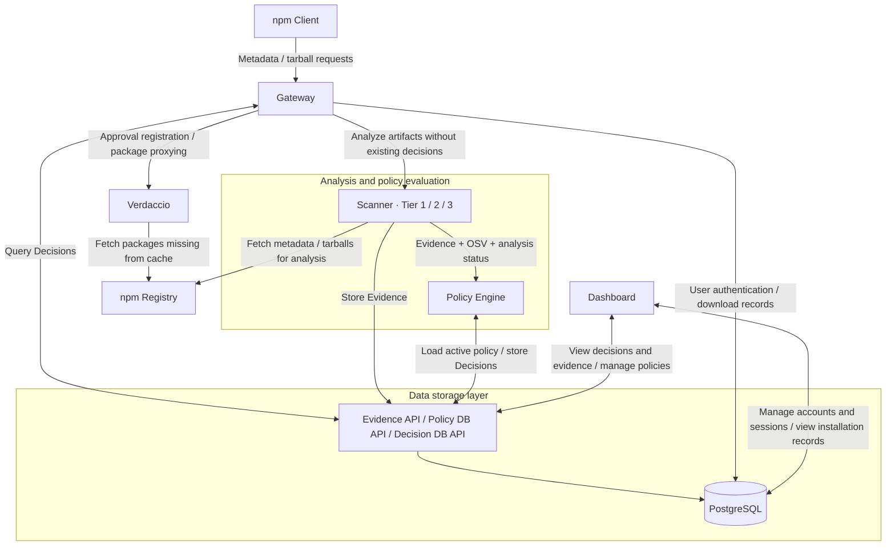
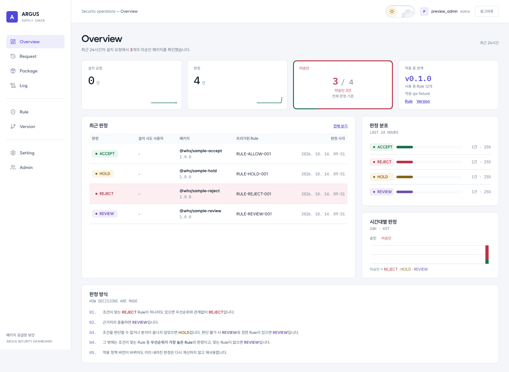
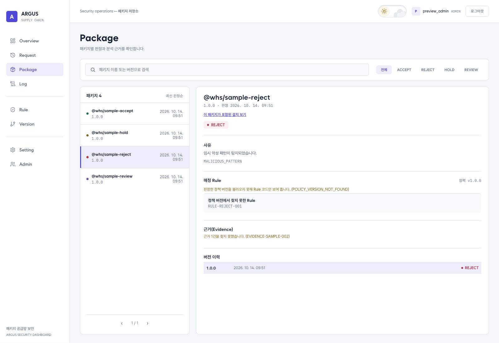
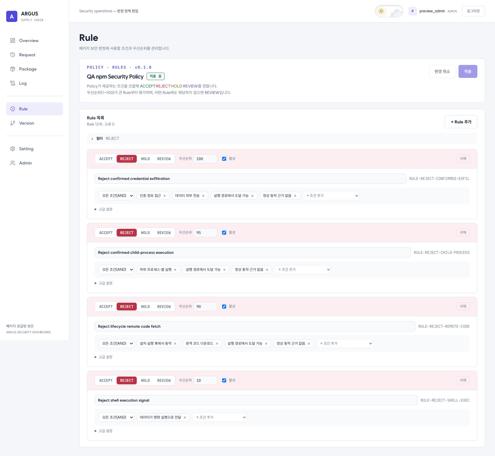

# ARGUS — Public Enemy (공공의 적)

[한국어](README.md) | **English**

## Project Origins

ARGUS is the result of the “Public Enemy” (공공의 적) team project from the fourth cohort of WhiteHat School, organized by the Korea Internet & Security Agency (KISA).

[](https://github.com/WHSProject/WHSproject-public/actions/workflows/pr-ci.yml)
[](https://github.com/WHSProject/WHSproject-public/actions/workflows/github-code-scanning/codeql)
[](https://scorecard.dev/viewer/?uri=github.com/WHSProject/WHSproject-public)
[](LICENSE)

[](apps/dashboard/package.json)
[](apps/scanner/package.json)
[](apps/policy/requirements.txt)
[](infra/postgres)
[](compose.yaml)

## Introduction

ARGUS (공공의 적, “Public Enemy”) is an npm security platform that analyzes package security risks and allows or blocks package downloads according to policy.

It performs static analysis of package source code and metadata, deobfuscates code for further inspection, and optionally uses Tier 3 LLM analysis to review code context when needed. It evaluates supply chain risks using signals such as install scripts, access to sensitive information, external communication, and process execution, together with known vulnerability information from OSV.

ARGUS connects analysis results to package download enforcement. The Gateway receives npm requests and checks existing decisions. Packages requiring analysis go through the Scanner and Policy Engine, which store the evidence and decisions. The Gateway then checks the stored decisions again and allows the download only when every artifact in the analysis scope has an `ACCEPT` decision. `REJECT`, `HOLD`, and `REVIEW` block downloads. Users can inspect the reasons and supporting evidence in the Dashboard.

ARGUS considers both the capabilities found in a package and the context in which they are used. Network access or an install script alone does not establish malicious behavior. Allow, reject, hold, and review decisions depend on the collected evidence, analysis coverage, and policy conditions.

Analysis uses the following sources:

- **Package collection:** Metadata and tarballs for regular and scoped packages hosted on the [npm Registry](https://www.npmjs.com).
- **Code and metadata analysis:** Risk signals in `package.json` and JavaScript/TypeScript source, including reanalysis of deobfuscated code.
- **Vulnerability enrichment:** Known vulnerabilities for the package and version from the OSV Feed, used in policy evaluation.

### Main Components

| Component | Responsibility |
|---|---|
| Gateway | Entry point for npm requests, authentication, and Decision enforcement |
| Scanner | Static package analysis and security Evidence generation |
| Policy Engine | Policy evaluation based on analysis results |
| PostgreSQL / API | Storage and management of Decisions, Evidence, and related data |
| Verdaccio | npm registry proxy and package delivery |
| Dashboard | Views for requests, decisions, and logs |

> Some advanced features and final E2E validation are still in progress. See the test documentation and release QA results for the validation status of individual features.

## Team and Maintainers

| Name | Role |
|---|---|
| 호서빈 [@biniyapp](https://github.com/biniyapp) | PM / Scanner |
| 정환희 [@jumptop](https://github.com/jumptop) | Gateway / Dashboard |
| 오지송 [@Oh-Jisong](https://github.com/Oh-Jisong) | Gateway / DevOps/QA |
| 백소정 [@werkk81](https://github.com/werkk81) | Verdaccio / Scanner |
| 최희수 [@chlgmltn](https://github.com/chlgmltn) | Scanner |
| 김혜진 [@magician-num1](https://github.com/magician-num1) | Scanner |
| 김한결 [@kimhangyeol00](https://github.com/kimhangyeol00) | Data/feeds |
| 조가현 [@gahyuncho](https://github.com/gahyuncho) | Data/feeds |

## Contents

- **Understand the project:** [Architecture](#architecture) · [Dashboard Preview](#dashboard-preview) · [Supported Scope](#supported-scope)
- **Run and use ARGUS:** [Getting Started](#getting-started) · [Usage Examples](#usage-examples) · [Troubleshooting](#troubleshooting)
- **Reference:** [Detection Rules and Analysis Evidence](#detection-rules-and-analysis-evidence) · [Environment Variables](#environment-variables) · [Development and Testing](#development-and-testing) · [Project Structure](#project-structure)
- **Project information:** [Team and Maintainers](#team-and-maintainers) · [OpenSSF Scorecard](#openssf-scorecard) · [License](#license)

Expand the collapsible sections to see detailed explanations and commands. Linked technical documents and the Dashboard screenshots may be in Korean.

## Architecture

ARGUS separates **request handling and enforcement (Gateway)**, **security evidence collection (Scanner)**, **policy decisions (Policy Engine)**, and **package delivery (Verdaccio)**. The Dashboard displays stored evidence and decisions and manages policies and accounts. The following description assumes `SCANNER_ENABLED=true`.

### System Overview



The npm client's registry entry point is the Gateway's `/npm/` route. Metadata requests are forwarded to Verdaccio after authentication; tarballs are delivered after analysis and decision checks. Verdaccio provides package proxying and caching, while the Scanner fetches its own files for analysis.

### From Request to Download

1. **Authentication:** The Gateway checks the expiry of the npm token issued by the Dashboard, the user's active status, and installation permissions. It accesses Verdaccio through a separate read-only service account instead of the user's token.
2. **Request classification:** Metadata requests retrieve package information. Inspection starts with a tarball request for a resolved version, so tarball requests are still inspected when a lockfile lets the client skip metadata lookups.
3. **Dependency resolution and existing decisions:** The Gateway resolves the requested package and its dependencies, then looks up each artifact's Decision using its package name, version, and integrity information. Only artifacts without an existing decision are sent to the Scanner.
4. **Analysis and decision storage:** The Scanner analyzes packages, stores Evidence, and requests a Policy evaluation. Policy evaluates the active policy against the analysis evidence and stores the result in the Decision DB.
5. **Decision recheck and enforcement:** The Gateway queries Decisions again for the same analysis targets. If all have an `ACCEPT` decision, it registers their package names, versions, and integrity information in Verdaccio's approval list and delivers the tarball. Any other decision or missing decision blocks the download.
6. **Recording and inspection:** The Gateway records download outcomes, user information, and decision information. The Dashboard displays these records alongside stored Decisions and Evidence.

The Gateway's analysis cache reduces dependency tree reconstruction. Cached artifacts still have their current Decisions checked and enforced. If a Scanner call fails after a decision has already been stored, the Gateway queries the database again to check that decision. It does not assume success for an artifact with no decision.

Implementation: [Tarball request handling](apps/gateway/src/controllers/tarball.controller.ts), [Analysis and recheck flow](apps/gateway/src/services/tarball-analysis.service.ts), [Decision enforcement](apps/gateway/src/services/decision-handler.service.ts)

### Scanner: From Collection to Tier 3

<details>
<summary>Processing stages, Evidence normalization, and optional LLM analysis</summary>

| Stage | Processing | Information passed to the next stage |
|---|---|---|
| Collection and validation | Registry lookup, tarball download and integrity verification, extraction, and package name/version validation | Validated artifact and metadata |
| Tier 1 | Metadata, Custom Rule, and GuardDog analysis for install scripts, sensitive information access, process execution, network communication, and other signals | Findings and locations in the original code |
| Tier 2 | Select obfuscation candidates, restore code with webcrack and Babel, and reanalyze | Detailed shadow results, validated Evidence candidates from restored code, and provenance |
| Evidence normalization | Convert original Findings and validated Tier 2 candidates into a shared format | Evidence linked to provenance, locations, and limitations |
| Tier 3 trigger assessment | Classify static analysis results as clear, ambiguous, or incomplete | Whether to run the Agent and the selected code context |
| Tier 3 | When enabled, analyze the required code context with an LLM Agent and validate the response | Validated `LLM_ASSESSMENT` and analysis summary |
| Policy handoff | Store Evidence and request evaluation with analysis status and OSV information | Policy evaluation request |

OSV Feed lookups add known vulnerability information for the package. Tier 3 runs when static analysis is ambiguous or incomplete and the Agent configuration is enabled; it is disabled by default. Not every package goes through the LLM Agent.

Raw Tier 2 results remain in `shadowAnalyses`, while validated candidates are normalized into Evidence with `TIER2` provenance and passed to Policy. Tier 3 results must also pass checks such as reference ID and response format validation before becoming Policy input. Temporary downloads, extracted files, and restored files are cleaned up after analysis.

Implementation: [Orchestrator](apps/scanner/src/application/orchestrator/orchestrator.ts), [Evidence normalization](apps/scanner/src/evidence/normalizer/evidence-normalizer.ts), [Policy request validation](apps/scanner/src/policy/policy-evaluation.request.ts), [Scan Service](apps/scanner/src/application/scan-service/scan.service.ts)

</details>

### Policy: Turning Evidence into Decisions

| Decision | Meaning | Gateway download behavior |
|---|---|---|
| `ACCEPT` | Allowed by policy | Allowed when all inspected artifacts have ACCEPT decisions |
| `REJECT` | Rejected by policy | Blocked |
| `HOLD` | Deferred, for example because evidence is insufficient or evaluation failed | Blocked |
| `REVIEW` | Further review required | Blocked |

<details>
<summary>Policy evaluation order, failure handling, and implementation</summary>

Policy loads the active policy and builds an evaluation context from Evidence, OSV information, and analysis status. In the default configuration, an LLM makes judgments about policy conditions. The server validates the response and evidence references, then a rule resolver determines the final Decision. The Scanner's Tier 3 Agent and Policy's LLM evaluation are separate paths.

Matching REJECT rules are processed first. The resolver then checks for conflicting evidence, indeterminate judgments, or insufficient analysis coverage before applying the remaining rule priorities and default decision. If the LLM call or response validation fails, it uses the active policy's `judgmentFailureDecision`.

An install script or network API alone does not establish malicious behavior. Findings, Evidence, policy condition judgments, and final Decisions are distinct; review their supporting evidence and limitations together.

Implementation: [Policy evaluation](apps/policy/src/evaluation/policy-evaluation.service.ts), [Decision resolution](apps/policy/src/decision/decision.resolver.ts)

</details>

### Data Storage and Dashboard

<details>
<summary>Logical databases, access paths, and decision traceability</summary>

PostgreSQL is divided into logical databases by purpose. Evidence, Policy, and Decision data are accessed through their respective APIs. The Gateway and Dashboard use `user_db` for user authentication and installation records.

| Logical database | Main data | Access path |
|---|---|---|
| `evidence_db` | Analysis evidence and LLM assessments | Evidence API |
| `policy_db` | Policies, rules, condition definitions, and policy versions | Policy DB API |
| `decision_db` | Final decisions, judgment audit records, and feed data | Decision DB API |
| `user_db` | Users, permissions, sessions, npm tokens, downloads, and installation dependency records | Database connections from the Gateway and Dashboard servers |

`requestId` links the request flow, while `scanId` links an individual analysis. Artifact names, versions, hashes/integrity values, Evidence IDs, policy versions, and Decision IDs help trace what was evaluated and why.

The Dashboard provides views for decisions, evidence, and logs, and manages policy versions and user permissions. The Gateway enforces npm package downloads. See [compose.yaml](compose.yaml) for public service ports and internal connections, [00-bootstrap.sql](infra/postgres/init/00-bootstrap.sql) for database initialization, and [packages/contracts](packages/contracts) for shared data formats.

</details>

## Dashboard Preview

These three screenshots were captured on 2026-10-14 by building the Dashboard from this repository and connecting it to a separate local database. The displayed packages, decisions, and policies are **QA sample data** from database initialization. They do not represent actual package analysis results or detection performance.

### 1. Overview — Security Status

View recent decisions, decision distribution, activity over time, and the active policy in one place.



### 2. Package — Decision Details

Inspect the decision reasons, matching rules, Evidence, and version history for a selected package version. The initial sample below displays missing-data notices because some referenced policy version and Evidence data are absent.



### 3. Rule — Policy Rule Management

Manage decision conditions, priorities, and enabled states. The view below filters the QA policy to show only REJECT rules.



## Supported Scope

- **Package ecosystem:** npm packages, including scoped packages. ARGUS uses GuardDog as an analyzer, but its registry integration does not extend to GuardDog's other supported ecosystems.
- **Source analysis:** Primarily Custom Rules for JavaScript/TypeScript and JavaScript deobfuscation. Analysis of every language or binary contained in a package is not guaranteed.
- **Inspection point:** Analysis and policy enforcement apply to tarball download requests passing through the Gateway. Metadata lookups alone do not trigger analysis. Downloads that bypass the Gateway and execution of already installed packages are outside its enforcement scope.

## Getting Started

For the first run, follow **environment setup and service startup → account and token setup → [Usage Examples](#usage-examples)**. Complete both setup sections below.

### Prerequisites

- Docker Desktop, or Docker Engine with Docker Compose
- Node.js and npm for the npm client
- A shell on macOS, Linux, or Git Bash; the account initialization examples below assume one of these environments
- Local code development: Node.js 24.x and pnpm 10.34.5
- Integration / E2E tests: Python 3.11 or later

The Docker images install the Scanner's Semgrep and GuardDog tools and the service runtimes. When running the full stack with Docker, you do not need to install the analysis tools separately on the host.

### Installation

Clone the repository and prepare the environment file in the project root. If you already have a clone, start with the `cp` command in that directory.

```bash
git clone https://github.com/WHSProject/WHSproject-public.git
cd WHSproject-public
cp .env.example .env
```

<details>
<summary>1. Set required environment variables and start services</summary>

Set the following values in `.env`. Replace the angle-bracketed placeholders with your own values.

```dotenv
POSTGRES_USER=WHS_project
POSTGRES_PASSWORD=<local database password>
SCANNER_ENABLED=true
VERDACCIO_PUBLIC_URL=http://localhost:3000
WHS_APPROVAL_SERVICE_TOKEN=<random secret shared by Gateway and Verdaccio>
VERDACCIO_SERVICE_USER=gateway-reader
VERDACCIO_SERVICE_PASSWORD=<password for the service account created below>
DASHBOARD_PUBLIC_URL=http://localhost:5173
BETTER_AUTH_SECRET=<random secret for Dashboard authentication>
POLICY_LLM_MODE=openai
OPENAI_API_KEY=<API key for Policy evaluation>
```

You can generate `WHS_APPROVAL_SERVICE_TOKEN` with `openssl rand -hex 32` and `BETTER_AUTH_SECRET` with `openssl rand -base64 32`. If host port 5432 is already in use, change `POSTGRES_PORT`.

The current default Policy uses the OpenAI API. A missing key or failed call applies the active policy's failure decision, which is `HOLD` in the default policy. `POLICY_LLM_MODE=fixture` is a development mode that returns fixed test responses without external calls; it does not validate real security decisions.

Build and start the services:

```bash
docker compose config --quiet
docker compose up -d --build
docker compose ps
```

</details>

### Initial Account Setup

<details>
<summary>2. Set up the Verdaccio service account, Dashboard administrator, and npm token</summary>

**1. Verdaccio service account**

Identify the running container's storage volume and open the account management menu. This works regardless of the name of your cloned directory.

```bash
export VERDACCIO_VOLUME="$(docker inspect whs-verdaccio --format '{{range .Mounts}}{{if eq .Destination "/verdaccio/storage"}}{{.Name}}{{end}}{{end}}')"
sh infra/verdaccio/scripts/manage-users.sh
```

Select **2. 사용자 추가 (Add user)**, create `gateway-reader`, and enter the same password as `VERDACCIO_SERVICE_PASSWORD` in `.env`. The Gateway uses this account to access Verdaccio. If you changed `.env`, apply the changes with:

```bash
docker compose up -d --force-recreate gateway
```

**2. Dashboard administrator**

```bash
docker compose exec dashboard node create-admin.js admin
```

Set a password using the one-time link printed by the command, then sign in to the [Dashboard](http://localhost:5173). If an administrator has already set a password, ask an existing administrator to create your account.

**3. npm token**

Issue a token in the Dashboard under **Settings → npm token (설정 → npm 토큰)**. Developer, Editor, and Admin roles have package installation permissions. The token value is shown only once, when issued.

Create a `.npmrc` file with the following content in the npm project directory where you will install packages:

```ini
registry=http://localhost:3000/npm/
//localhost:3000/npm/:_authToken=${ARGUS_NPM_TOKEN}
fetch-timeout=360000
```

Set the issued token as the `ARGUS_NPM_TOKEN` environment variable in your current shell. Keep the environment variable reference shown above in `.npmrc`; do not commit the actual token.

The legacy `npm login --auth-type=legacy` path returns `410 NPM_LOGIN_DISABLED`. Verdaccio management accounts are managed separately from Dashboard users and npm tokens.

</details>

> The default Policy uses the OpenAI API. `fixture` mode is for development and testing and does not validate real security decisions. Do not commit passwords, API keys, or actual npm tokens.

## Usage Examples

Run these commands from the npm project directory where authentication is configured.

```bash
# Check authentication and registry connectivity with a metadata lookup
npm view is-number@7.0.0 version --registry=http://localhost:3000/npm/

# Install a specific version: tarball requests trigger analysis, decisions, and enforcement
npm install is-number@7.0.0 --registry=http://localhost:3000/npm/ --ignore-scripts

# Look up a scoped package
npm view @babel/core version --registry=http://localhost:3000/npm/
```

A successful metadata lookup does not mean the package is approved for installation. Installation may be blocked by the active policy and stored Decisions. The installation example uses `--ignore-scripts` to avoid running npm lifecycle scripts.

Use the Dashboard to view requests, package decisions, and logs. Users with the appropriate permissions can also manage policies and user accounts.

| Service | Default address |
|---|---|
| npm registry entry point | `http://localhost:3000/npm/` |
| Dashboard | `http://localhost:5173` |

The Scanner and Verdaccio are accessed through the internal Compose network. The default configuration is intended for local use. See [compose.yaml](compose.yaml) for ports and service connections.

## Troubleshooting

<details>
<summary>Authentication errors (401/403/410), registry connection failures, and HOLD decisions</summary>

| Symptom | What to check |
|---|---|
| npm requests return `401` | Check the `/npm/:_authToken` path in `.npmrc`, the `ARGUS_NPM_TOKEN` environment variable, and token expiry. |
| npm requests or downloads are blocked with `403` | Check the user's active status and installation permissions, then inspect the Decisions and evidence for the package and its dependencies in the Dashboard. Distinguish policy blocks from missing permissions. |
| `npm login` returns `410 NPM_LOGIN_DISABLED` | Issue an npm token in Dashboard settings and reference it from `.npmrc`. |
| Registry requests fail even though containers are running | Confirm that `gateway-reader` exists in the actual Verdaccio storage volume, its password matches the service account password in `.env`, and `WHS_APPROVAL_SERVICE_TOKEN` is set. |
| A Policy evaluation failure produces `HOLD` | Check whether the reason is `POLICY_LLM_UNAVAILABLE`, then inspect `OPENAI_API_KEY`, model settings, and external API connectivity. Not every HOLD indicates an API error. |

Check service status and recent logs from the repository root:

```bash
docker compose ps
docker compose logs --tail=100 gateway scanner policy
```

</details>

## Detection Rules and Analysis Evidence

Static analysis can produce false positives and false negatives. Review observed signals, analysis errors, and evidence limitations together. Detection results alone cannot guarantee all runtime behavior.

<details>
<summary>Detection coverage, rules, and implementation links by analysis area</summary>

| Analysis area | What it checks | Implementation / configuration |
|---|---|---|
| Metadata | Lifecycle scripts and license/repository mismatches between the registry and package.json | [Metadata Analyzer](apps/scanner/src/analyzers/metadata/metadata.analyzer.ts) |
| Custom Rule | Access to sensitive files and environment variables, process execution, network communication, and combinations of signals | [Semgrep rules](apps/scanner/rules/custom-rule-analyzer.yml), [Custom Rule Analyzer](apps/scanner/src/analyzers/custom-rule/custom-rule.analyzer.ts) |
| GuardDog | Supply chain risk signals in package source and metadata | [GuardDog Adapter](apps/scanner/src/analyzers/guarddog/guarddog.analyzer.ts) |
| Obfuscation analysis | Select restoration candidates, reanalyze restored code, and link evidence from original and restored code | [Obfuscation Analyzer](apps/scanner/src/analyzers/obfuscation/obfuscation.analyzer.ts) |
| OSV Feed | Known vulnerabilities associated with a package and version | [OSV integration guide](apps/scanner/src/osv/README.md) |
| Policy | Evaluate policy conditions from Evidence and determine the final Decision | [Default policy](apps/policy/src/policy/default-policy.ts) |

Shared Evidence and Policy formats are maintained in [packages/contracts](packages/contracts). For the detailed obfuscation and LLM flows, see the [Agent analysis request contract](docs/obfuscation-agent-analysis-request.md) and [LLM usage and prompt design](docs/obfuscation-llm-prompting.md).

</details>

## Environment Variables

See [.env.example](.env.example) for the full list. The values below assume a local setup using that example file.

<details>
<summary>Environment variable defaults and purposes</summary>

| Variable | Default | Purpose |
|---|---|---|
| `SCANNER_ENABLED` | `true` | Enable the Gateway's Scanner integration |
| `SCANNER_PACKAGE_TIMEOUT_MS` | `240000` | Analysis time limit per package |
| `SCANNER_TIMEOUT_MS` | `300000` | How long the Gateway waits for a Scanner response |
| `WHS_APPROVAL_SERVICE_TOKEN` | Set manually | Shared authentication secret for the Gateway and Verdaccio Approval API |
| `VERDACCIO_SERVICE_USER` / `VERDACCIO_SERVICE_PASSWORD` | Set manually | The Gateway's read-only Verdaccio account |
| `BETTER_AUTH_SECRET` | Set manually | Protect Dashboard login cookies and tokens |
| `POLICY_LLM_MODE` | `openai` | Policy evaluation provider; `fixture` is for development and testing |
| `OPENAI_API_KEY` | Set manually | Key for the default Policy and optional OpenAI analysis |
| `LLM_AGENT_ENABLED` | `false` | Enable the Tier 3 Agent |
| `LLM_AGENT_TRIGGER_MODE` | `RISK_BASED` | Tier 3 execution setting; `DISABLED` prevents execution |
| `OBFUSCATION_GPT_MODE` | `off` | Auxiliary LLM analysis for obfuscation; even in `shadow` mode, the auxiliary response itself does not affect Policy decisions |
| `OBFUSCATION_LLM_PROVIDER` | `gpt` | Auxiliary obfuscation analysis provider: `gpt` or `gemini` |
| `WHS_STORAGE_MODE` | `local` | Verdaccio storage; use `s3` when configuring S3 |

</details>

The Tier 3 Agent, auxiliary obfuscation LLM analysis, and Policy LLM evaluation are separate paths. Turning off the Scanner's LLM options does not disable the default Policy's external API calls. When LLM features are used, the analysis evidence and code context for that path are sent to the configured provider.

`SCANNER_ENABLED=false` disables the analysis and enforcement path for development purposes. Keep it set to `true` in environments that use package security inspection.

## Development and Testing

<details>
<summary>Local development: install, typecheck, test, and build commands by component</summary>

### Local Checks

Run these commands from the repository root. Scanner and Policy use the pnpm workspace; Gateway and Dashboard use the npm lockfile in their respective directories.

```bash
corepack enable
corepack prepare pnpm@10.34.5 --activate

# Scanner
pnpm install --filter scanner --frozen-lockfile
pnpm --filter scanner typecheck
pnpm --filter scanner test
pnpm --filter scanner build

# Policy
pnpm install --filter policy --frozen-lockfile
pnpm --filter policy typecheck
pnpm --filter policy build
pnpm --filter policy test

# Gateway
npm --prefix apps/gateway ci
npm --prefix apps/gateway test -- --runInBand
npm --prefix apps/gateway run build

# Dashboard
npm --prefix apps/dashboard ci
npm --prefix apps/dashboard run lint
npm --prefix apps/dashboard run typecheck
npm --prefix apps/dashboard test
npm --prefix apps/dashboard run build
```

Scanner checks that invoke external analysis tools also require a runtime with Semgrep and GuardDog installed. See [PR CI](.github/workflows/pr-ci.yml) and the [local PR CI guide](docs/local-pr-ci.md) for Python API checks and the full CI procedure.

</details>

<details>
<summary>Integration validation: Integration / E2E procedures and operations / demo guides</summary>

### Integration / E2E

After starting the services and configuring npm authentication, set the authentication file path from the repository root. If your `.npmrc` uses an environment variable reference, `ARGUS_NPM_TOKEN` must also be set in the test shell.

```bash
export QA_NPMRC=/absolute/path/to/your-project/.npmrc

# Check service health, configuration, and metadata lookup
python3 tests/e2e/critical_path.py --preflight-only --npmrc "$QA_NPMRC"

# Check actual installation, Decision storage, and enforcement
python3 tests/e2e/critical_path.py --npmrc "$QA_NPMRC"
```

The full E2E test performs an actual package installation and requires a confirmed `ACCEPT` decision to pass. It does not bypass existing `REJECT`, `HOLD`, or `REVIEW` decisions.

- [Integration tests](tests/integration/README.md)
- [E2E tests](tests/e2e/README.md)
- [Verdaccio configuration and operations](infra/verdaccio/README.md)
- [Demo runbook](docs/demo-runbook.md)

</details>

### Contributing

Follow [CONTRIBUTING.md](CONTRIBUTING.md) and [GIT_WORKFLOW.md](GIT_WORKFLOW.md) for branch, commit, and pull request rules. Create a branch from `dev` for a specific purpose, run the relevant checks, and submit a pull request targeting `dev`.

## Project Structure

<details>
<summary>Directory responsibilities and source code links</summary>

| Path | Contents |
|---|---|
| [apps/gateway](apps/gateway) | npm authentication, dependency lookup, and Decision enforcement |
| [apps/scanner](apps/scanner) | Package collection, static analysis, deobfuscation, and LLM Agent |
| [apps/policy](apps/policy) | Policy evaluation, Data / Feeds, and database APIs |
| [apps/dashboard](apps/dashboard) | Web dashboard and user / permission management |
| [infra](infra) | Infrastructure configuration, including Verdaccio and PostgreSQL |
| [packages/contracts](packages/contracts) | Shared Evidence, Policy, and Agent contracts |
| [tests](tests) | Integration and E2E tests |
| [docs](docs) | Technical documentation and runbooks |
| [compose.yaml](compose.yaml) | Configuration for running all services together |

</details>

## OpenSSF Scorecard

[OpenSSF Scorecard](https://scorecard.dev/) automatically checks repository security practices such as branch protection, code review, CI tests, static analysis, and workflow token permissions. It is separate from ARGUS's package malware analysis. A Scorecard score is neither a guarantee that the project is vulnerability-free nor a security certification.

[View the public report](https://scorecard.dev/viewer/?uri=github.com/WHSProject/WHSproject-public) · [Workflow runs](https://github.com/WHSProject/WHSproject-public/actions/workflows/scorecard.yml)

<details>
<summary>Scan schedule, results, and execution environment</summary>

The [Scorecard workflow](.github/workflows/scorecard.yml) is configured to run when changes reach `main` and every Saturday at 10:30 KST. Results are published to OpenSSF, and the badge at the top links to the latest public results. A score may not appear until the first run and publication have completed.

- [Public repository report](https://scorecard.dev/viewer/?uri=github.com/WHSProject/WHSproject-public)
- [Workflow runs](https://github.com/WHSProject/WHSproject-public/actions/workflows/scorecard.yml) · [GitHub Code scanning](https://github.com/WHSProject/WHSproject-public/security/code-scanning)
- [Checks and score interpretation](https://github.com/ossf/scorecard/blob/main/docs/checks.md)

The workflow uses standard GitHub-hosted runners for public repositories and does not require a personal PAT or LLM API key. It does not save separate Actions artifacts or caches. Results are available through the public report and SARIF results in GitHub Code scanning, including checks with low scores.

</details>

## License

Unless otherwise noted, original ARGUS code is provided under the [Apache License 2.0](LICENSE).

External materials and third-party software retain their original licenses. See [THIRD_PARTY_NOTICES.md](THIRD_PARTY_NOTICES.md) for details.
