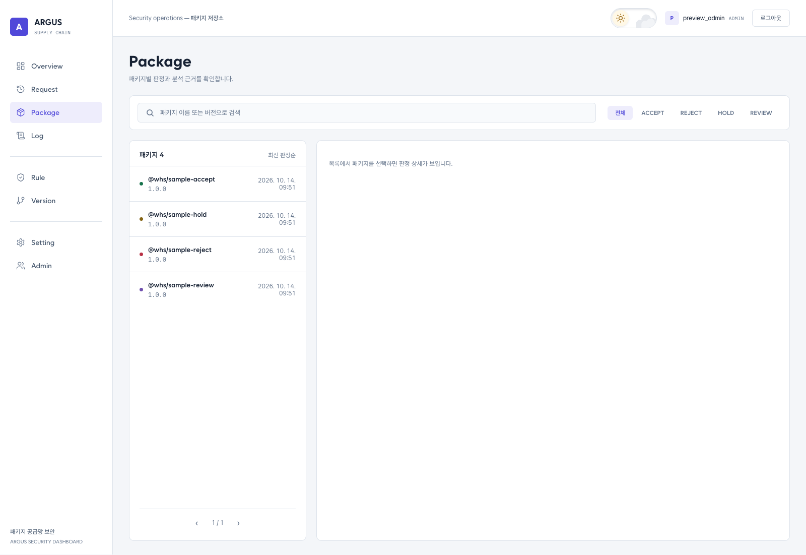
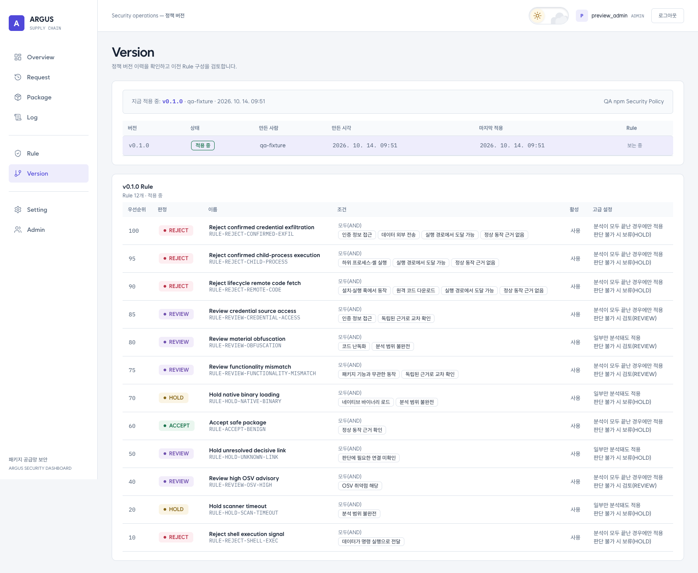
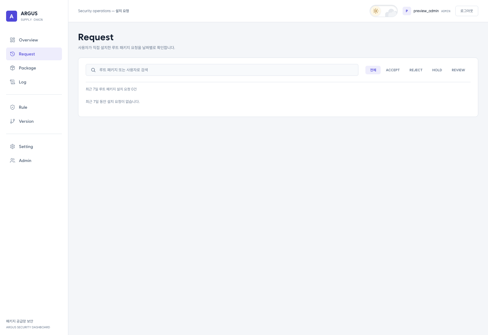
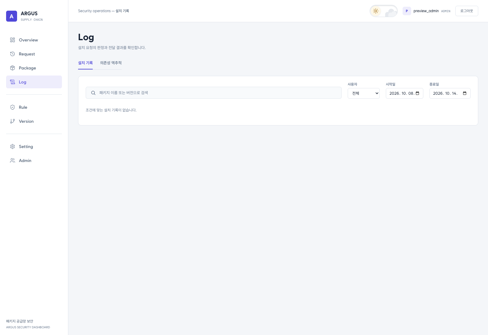
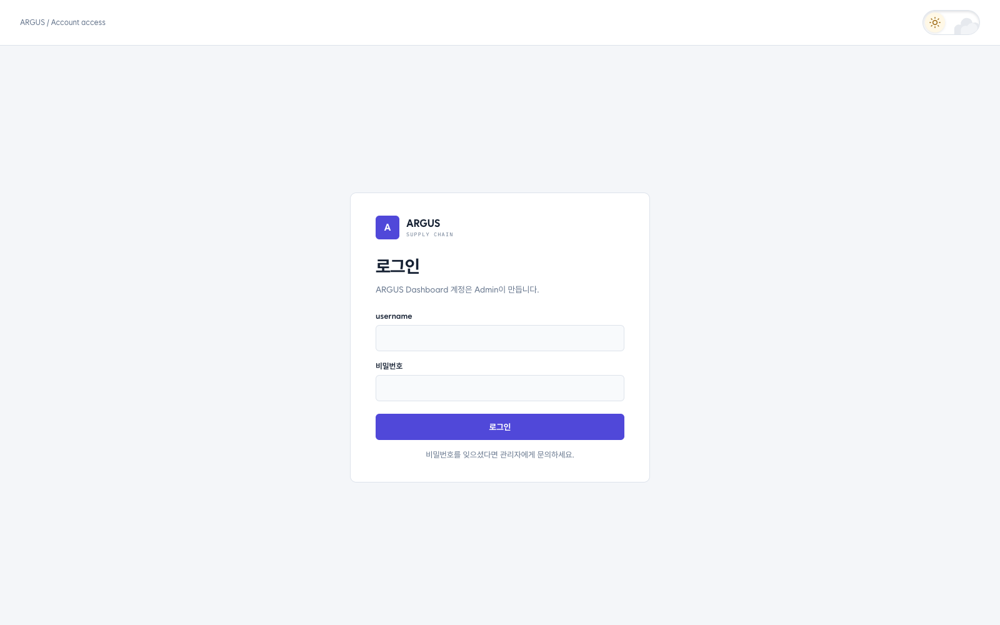
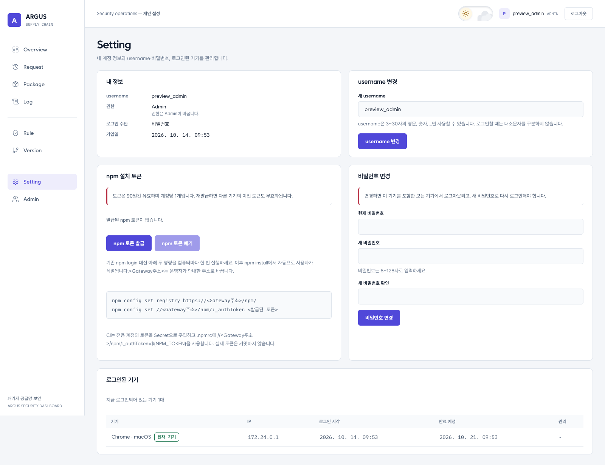
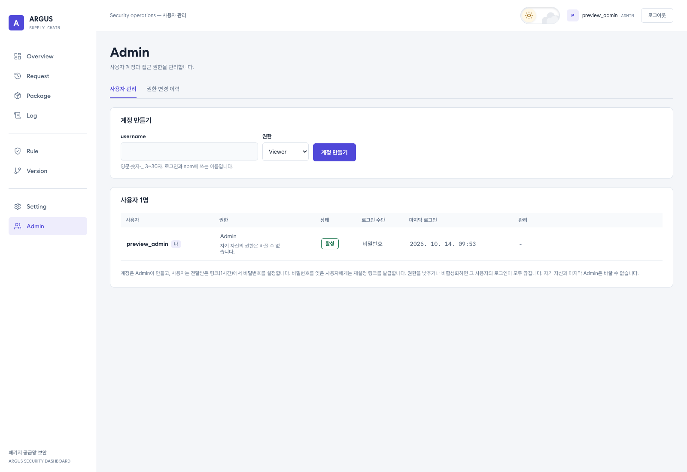

# 공공의 적

## 프로젝트 출처

ARGUS는 한국인터넷진흥원(KISA)이 주관하는 화이트햇스쿨 4기 팀 프로젝트 「공공의 적」의 결과물입니다.

## 소개

공공의 적(Argus)은 npm 패키지의 보안 위험을 분석하고, 정책에 따라 패키지 다운로드를 허용하거나 차단하는 NPM Security Platform입니다.

Gateway를 통해 들어온 요청은 기존 판정 여부에 따라 처리되며, 신규 분석이 필요한 경우 Scanner와 Policy Engine을 거쳐 Decision을 저장하고 집행합니다.

### 주요 구성 요소

| 구성 요소 | 역할 |
|---|---|
| Gateway | npm 요청 진입점, 인증 및 Decision 집행 |
| Scanner | 패키지 정적 분석 및 보안 Evidence 생성 |
| Policy Engine | 분석 결과 기반 정책 평가 |
| PostgreSQL / API | Decision, Evidence 및 관련 데이터 관리 |
| Verdaccio | npm Registry Proxy 및 패키지 전달 |
| Dashboard | 요청·판정·로그 조회 |

> 일부 고도화 기능과 최종 E2E 검증은 진행 중입니다. 개별 기능의 검증 상태는 테스트 문서와 릴리스 QA 결과를 참고해 주세요.

## 팀원

| 이름 | 역할 |
|---|---|
| 호서빈 | PM | 
| 정환희 | Gateway | 
| 오지송 | Gateway/DevOps/QA | 
| 백소정 | Verdaccio | 
| 최희수 | Scanner |
| 김혜진 | Scanner | 
| 김한결 | Data/feeds | 
| 조가현 | Data/feeds |

## 목차

- [대시보드 미리보기](#대시보드-미리보기)
- [동작 방식](#동작-방식)
- [지원 범위](#지원-범위)
- [시작하기](#시작하기)
- [사용 예시](#사용-예시)
- [문제 해결](#문제-해결)
- [탐지 규칙과 분석 근거](#탐지-규칙과-분석-근거)
- [환경변수 설정](#환경변수-설정)
- [개발 및 테스트](#개발-및-테스트)
- [프로젝트 구조](#프로젝트-구조)
- [팀원](#팀원)
- [라이선스](#라이선스)

## 대시보드 미리보기

아래 이미지는 2026-10-14에 현재 저장소의 Dashboard를 빌드하고, 별도의 로컬 DB에 연결해 브라우저에서 직접 촬영한 화면입니다. 화면의 패키지·판정·정책은 DB 초기화에 포함된 **QA 샘플 데이터**이며, 실제 패키지 분석 결과나 탐지 성능을 나타내지 않습니다.

### Overview

최근 판정, 판정 분포, 시간대별 현황과 적용 중인 정책을 한 화면에서 확인합니다.


<details>
<summary>패키지 목록과 판정 상세 보기</summary>

패키지별 판정을 검색·필터링하고 선택한 버전의 판정 사유, 정책, Evidence와 버전 이력을 조회합니다.



초기 샘플 판정이 참조하는 정책 버전과 Evidence 일부는 DB에 없어, 아래 상세 화면에는 해당 데이터의 누락 안내가 표시됩니다.


</details>

<details>
<summary>정책 규칙과 버전 관리 보기</summary>

Rule 화면에서 판정 조건·우선순위·활성 상태를 관리합니다. 아래는 QA 정책에 REJECT 필터를 적용한 모습입니다.


Version 화면에서 적용 중인 버전과 해당 버전의 규칙 구성을 확인합니다.



</details>

<details>
<summary>설치 요청과 로그 보기</summary>

Request는 루트 패키지의 설치 요청을, Log는 설치 기록과 의존성 역추적을 제공합니다. 촬영용 환경에서는 실제 npm 설치를 수행하지 않아 두 화면에 설치 이력이 없습니다.





</details>

<details>
<summary>로그인·개인 설정·사용자 관리 보기</summary>

관리자가 생성한 계정으로 로그인합니다.



Setting에서 계정 정보, npm 설치 토큰과 로그인된 기기를 관리합니다. 아래 화면은 npm 토큰을 발급하지 않은 촬영용 계정입니다.



Admin에서 사용자 계정을 생성하고 역할과 활성 상태를 관리합니다.



</details>

## 동작 방식

ARGUS는 npm Registry 앞에서 패키지 다운로드 요청을 검사합니다. 기존 판정을 조회하고, 분석이 필요한 패키지는 Scanner와 Policy Engine을 거쳐 처리합니다.

```text
npm Client → Gateway 인증 → 패키지·의존성의 기존 Decision 조회
                              │
                              ├─ 판정 있음 → 기존 Decision 확인
                              └─ 판정 없음 → Scanner → Policy Engine → Decision 저장
                                                                      │
                       Gateway 판정 재확인 ←───────────────────────────┘
                              │
                              ├─ 모두 ACCEPT → Verdaccio 승인 등록 → 패키지 전달
                              └─ 그 외       → 다운로드 차단
```

### 패키지 분석

1. **수집·검증:** Registry 메타데이터와 tarball을 가져와 무결성을 검증하고, 압축 해제 후 패키지 이름과 버전을 확인합니다.
2. **Tier 1 — 정적 분석:** Metadata, Custom Rule, GuardDog 분석으로 설치 스크립트, 민감 정보 접근, 네트워크 통신 등 위험 신호를 수집합니다. OSV Feed로 알려진 취약점 정보도 조회합니다.
3. **Tier 2 — 난독화 복원·재분석:** 난독화 후보를 선별하고 webcrack·Babel 기반 복원과 재분석을 수행합니다. 상세 결과는 `shadowAnalyses`에 남기며, 검증을 통과한 후보는 `TIER2` 출처를 가진 Evidence로 정규화합니다.
4. **Tier 3 — 선택적 LLM 분석:** 정적 분석이 불완전하거나 모호한 경우, 활성화된 Agent가 선별된 코드 문맥을 분석합니다. 검증된 `LLM_ASSESSMENT`만 Policy 입력에 포함합니다. 기본값은 비활성화입니다.
5. **정책 평가·집행:** Policy Engine이 Evidence와 OSV 정보로 정책 조건을 평가하고 Decision을 저장합니다. Gateway는 저장된 판정을 다시 조회해 다운로드를 허용하거나 차단합니다.

Tier 2의 원시 Shadow 결과, 정규화된 Evidence, 최종 Decision은 서로 다른 데이터입니다. 설치 스크립트나 네트워크 API가 발견되었다는 사실만으로 악성 판정을 확정하지 않습니다. LLM 응답도 검증과 정책 평가를 거칩니다.

구현은 [Scanner Orchestrator](apps/scanner/src/application/orchestrator/orchestrator.ts), [Policy 평가](apps/policy/src/evaluation/policy-evaluation.service.ts), [Gateway 집행](apps/gateway/src/services/decision-handler.service.ts)에서 확인할 수 있습니다.

### 판정 결과

| Decision | 의미 | Gateway 다운로드 처리 |
|---|---|---|
| `ACCEPT` | 정책상 허용 | 검사 대상이 모두 ACCEPT인 경우 허용 |
| `REJECT` | 정책상 거부 | 차단 |
| `HOLD` | 판단 근거 부족 또는 평가 실패 등에 따른 보류 | 차단 |
| `REVIEW` | 추가 검토 필요 | 차단 |

분석 후에도 판정이 없으면 다운로드를 허용하지 않습니다. 구체적인 판정 조건은 활성 정책에 따라 달라집니다.

## 지원 범위

- **패키지 생태계:** npm 패키지와 scoped 패키지를 대상으로 합니다. GuardDog를 분석기로 사용하지만, ARGUS의 Registry 연동이 GuardDog의 다른 생태계까지 지원하는 것은 아닙니다.
- **소스 분석:** JavaScript·TypeScript용 Custom Rule과 JavaScript 난독화 복원을 중심으로 분석합니다. 패키지에 포함된 모든 언어와 바이너리를 분석한다고 보장하지 않습니다.
- **검사 시점:** Gateway를 통과하는 tarball 다운로드 요청에서 분석과 정책 집행을 수행합니다. Metadata 조회만으로 분석이 실행되지는 않으며, Gateway를 거치지 않는 다운로드와 이미 설치된 패키지의 실행은 통제 범위에 포함되지 않습니다.

## 시작하기

### 실행 환경

- Docker Desktop 또는 Docker Engine과 Docker Compose
- npm Client용 Node.js와 npm
- macOS·Linux·Git Bash용 셸 — 아래 계정 초기화 예시는 이 환경을 기준으로 합니다.
- 로컬 코드 개발: Node.js 24.x, pnpm 10.34.5
- Integration / E2E 테스트: Python 3.11 이상

Scanner의 Semgrep·GuardDog와 서비스 런타임은 Docker 이미지에서 설치합니다. 전체 스택을 Docker로 실행할 때는 호스트에 분석 도구를 별도로 설치할 필요가 없습니다.

### 설치

저장소를 클론하고 프로젝트 루트에서 환경파일을 준비합니다. 이미 클론했다면 해당 폴더에서 `cp` 명령부터 진행합니다.

```bash
git clone https://github.com/WHSProject/WHSproject-public.git
cd WHSproject-public
cp .env.example .env
```

`.env`에서 다음 값을 설정합니다. 꺾쇠로 표시한 값은 직접 채워야 합니다.

```dotenv
POSTGRES_USER=WHS_project
POSTGRES_PASSWORD=<로컬 DB 비밀번호>
SCANNER_ENABLED=true
VERDACCIO_PUBLIC_URL=http://localhost:3000
WHS_APPROVAL_SERVICE_TOKEN=<Gateway와 Verdaccio가 공유할 임의의 비밀값>
VERDACCIO_SERVICE_USER=gateway-reader
VERDACCIO_SERVICE_PASSWORD=<아래에서 생성할 서비스 계정 비밀번호>
DASHBOARD_PUBLIC_URL=http://localhost:5173
BETTER_AUTH_SECRET=<Dashboard 인증용 임의의 비밀값>
POLICY_LLM_MODE=openai
OPENAI_API_KEY=<Policy 평가에 사용할 API 키>
```

`WHS_APPROVAL_SERVICE_TOKEN`은 `openssl rand -hex 32`, `BETTER_AUTH_SECRET`은 `openssl rand -base64 32`로 각각 생성할 수 있습니다. 호스트의 5432 포트가 사용 중이면 `POSTGRES_PORT`를 변경합니다.

현재 기본 Policy는 OpenAI API를 사용합니다. 키 누락·호출 실패 시 활성 정책의 실패 판정이 적용되며, 기본 정책에서는 `HOLD`입니다. `POLICY_LLM_MODE=fixture`는 외부 호출 없이 고정된 테스트 응답을 사용하는 개발용 모드이므로 실제 보안 판정 검증과 구분해야 합니다.

서비스를 빌드하고 실행합니다.

```bash
docker compose config --quiet
docker compose up -d --build
docker compose ps
```

### 최초 계정 설정

**1. Verdaccio 서비스 계정**

실제 컨테이너의 저장 볼륨을 확인하고 계정 관리 메뉴를 엽니다. 클론한 폴더 이름이 달라도 같은 방식으로 사용할 수 있습니다.

```bash
export VERDACCIO_VOLUME="$(docker inspect whs-verdaccio --format '{{range .Mounts}}{{if eq .Destination "/verdaccio/storage"}}{{.Name}}{{end}}{{end}}')"
sh infra/verdaccio/scripts/manage-users.sh
```

메뉴에서 **2. 사용자 추가**를 선택해 `gateway-reader`를 만들고, `.env`의 `VERDACCIO_SERVICE_PASSWORD`와 동일한 비밀번호를 입력합니다. Gateway는 이 계정으로 Verdaccio에 접근합니다. `.env` 값을 바꿨다면 다음 명령으로 반영합니다.

```bash
docker compose up -d --force-recreate gateway
```

**2. Dashboard 관리자**

```bash
docker compose exec dashboard node create-admin.js admin
```

출력된 일회용 링크에서 비밀번호를 설정하고 [Dashboard](http://localhost:5173)에 로그인합니다. 비밀번호를 설정한 관리자가 이미 있다면 기존 관리자에게 계정 생성을 요청합니다.

**3. npm 토큰**

Dashboard의 **설정 → npm 토큰**에서 토큰을 발급합니다. 패키지 설치 권한은 Developer·Editor·Admin에게 있습니다. 토큰 원문은 발급 시 한 번만 표시됩니다.

작업할 npm 프로젝트 폴더에서 아래 내용을 `.npmrc`에 작성합니다.

```ini
registry=http://localhost:3000/npm/
//localhost:3000/npm/:_authToken=${ARGUS_NPM_TOKEN}
fetch-timeout=360000
```

발급받은 토큰을 현재 셸의 `ARGUS_NPM_TOKEN` 환경변수로 설정합니다. `.npmrc`에는 위 환경변수 참조를 그대로 유지하고, 실제 토큰은 커밋하지 않습니다.

기존 `npm login --auth-type=legacy` 경로는 `410 NPM_LOGIN_DISABLED`를 반환합니다. Verdaccio 관리 계정과 Dashboard 사용자·npm 토큰은 별도로 관리됩니다.

## 사용 예시

인증을 설정한 npm 프로젝트 폴더에서 실행합니다.

```bash
# Metadata 조회로 인증과 Registry 연결 확인
npm view is-number@7.0.0 version --registry=http://localhost:3000/npm/

# 특정 버전 설치: tarball 요청 시 분석·판정·집행 수행
npm install is-number@7.0.0 --registry=http://localhost:3000/npm/ --ignore-scripts

# Scoped 패키지 조회
npm view @babel/core version --registry=http://localhost:3000/npm/
```

Metadata 조회 성공은 해당 패키지의 설치 승인을 의미하지 않습니다. 설치는 적용 중인 정책과 저장된 Decision에 따라 차단될 수 있습니다. 위 설치 예시는 npm lifecycle script를 실행하지 않도록 `--ignore-scripts`를 사용합니다.

Dashboard에서 요청·패키지 판정·로그를 조회하고, 권한이 있는 사용자는 정책과 사용자 계정을 관리할 수 있습니다.

| 서비스 | 기본 주소 |
|---|---|
| npm Registry 진입점 | `http://localhost:3000/npm/` |
| Dashboard | `http://localhost:5173` |

Scanner와 Verdaccio는 Compose 내부 네트워크에서 접근합니다. 기본 구성은 로컬 실행 기준이며, 포트와 서비스 연결은 [compose.yaml](compose.yaml)을 참고하세요.

## 문제 해결

| 증상 | 확인할 내용 |
|---|---|
| npm 요청이 `401`로 거부됨 | `.npmrc`의 `/npm/:_authToken` 경로, `ARGUS_NPM_TOKEN` 환경변수, 토큰 만료 여부를 확인합니다. |
| npm 요청 또는 다운로드가 `403`으로 차단됨 | 사용자 활성 상태와 설치 권한을 확인하고, Dashboard에서 해당 패키지·의존성의 Decision과 근거를 확인합니다. 정책 차단과 권한 부족을 구분해야 합니다. |
| `npm login`이 `410 NPM_LOGIN_DISABLED`를 반환함 | Dashboard의 설정에서 npm 토큰을 발급해 `.npmrc`에 연결합니다. |
| 컨테이너는 실행 중인데 Registry 요청이 실패함 | `gateway-reader`가 실제 Verdaccio 저장 볼륨에 존재하는지, `.env`의 서비스 계정 비밀번호와 일치하는지, `WHS_APPROVAL_SERVICE_TOKEN`이 설정되어 있는지 확인합니다. |
| Policy 평가 실패로 `HOLD`가 기록됨 | 판정 사유가 `POLICY_LLM_UNAVAILABLE`인지 확인하고, `OPENAI_API_KEY`·모델 설정·외부 API 연결 상태를 점검합니다. 모든 HOLD가 API 오류를 뜻하는 것은 아닙니다. |

서비스 상태와 최근 로그는 저장소 루트에서 확인합니다.

```bash
docker compose ps
docker compose logs --tail=100 gateway scanner policy
```

## 탐지 규칙과 분석 근거

| 분석 영역 | 확인하는 내용 | 구현·설정 |
|---|---|---|
| Metadata | lifecycle script 존재, Registry와 package.json의 license·repository 불일치 | [Metadata Analyzer](apps/scanner/src/analyzers/metadata/metadata.analyzer.ts) |
| Custom Rule | 민감 파일·환경변수 접근, 프로세스 실행, 네트워크 통신 및 신호 조합 | [Semgrep 규칙](apps/scanner/rules/custom-rule-analyzer.yml), [Custom Rule Analyzer](apps/scanner/src/analyzers/custom-rule/custom-rule.analyzer.ts) |
| GuardDog | 패키지 소스·메타데이터의 공급망 위험 신호 | [GuardDog Adapter](apps/scanner/src/analyzers/guarddog/guarddog.analyzer.ts) |
| 난독화 분석 | 복원 후보 선별, 복원본 재분석, 원본과 복원본의 근거 연결 | [Obfuscation Analyzer](apps/scanner/src/analyzers/obfuscation/obfuscation.analyzer.ts) |
| OSV Feed | 패키지·버전과 연결된 알려진 취약점 정보 | [OSV 연동 안내](apps/scanner/src/osv/README.md) |
| Policy | Evidence를 바탕으로 정책 조건 평가 및 최종 Decision 결정 | [기본 정책](apps/policy/src/policy/default-policy.ts) |

정적 분석 결과에는 오탐·미탐이 있을 수 있습니다. 관찰 신호, 분석 오류, 근거의 한계를 함께 확인해야 하며, 탐지 결과만으로 실행 시의 모든 동작을 보장하지 않습니다.

Evidence와 Policy의 공통 형식은 [packages/contracts](packages/contracts)에서 관리합니다. 난독화·LLM의 상세 흐름은 [Agent 분석 요청 계약](docs/obfuscation-agent-analysis-request.md)과 [LLM 사용 및 프롬프트 설계](docs/obfuscation-llm-prompting.md)를 참고하세요.

## 환경변수 설정

전체 항목은 [.env.example](.env.example)에 있습니다. 아래 값은 해당 예제 파일을 사용하는 로컬 실행 기준입니다.

| 환경변수 | 기본값 | 역할 |
|---|---|---|
| `SCANNER_ENABLED` | `true` | Gateway의 Scanner 연동 활성화 |
| `SCANNER_PACKAGE_TIMEOUT_MS` | `240000` | 패키지 한 건의 분석 제한 시간 |
| `SCANNER_TIMEOUT_MS` | `300000` | Gateway의 Scanner 응답 대기 시간 |
| `WHS_APPROVAL_SERVICE_TOKEN` | 별도 설정 | Gateway와 Verdaccio Approval API의 공유 인증값 |
| `VERDACCIO_SERVICE_USER` / `VERDACCIO_SERVICE_PASSWORD` | 별도 설정 | Gateway의 Verdaccio 읽기 전용 계정 |
| `BETTER_AUTH_SECRET` | 별도 설정 | Dashboard 로그인 쿠키·토큰 보호 |
| `POLICY_LLM_MODE` | `openai` | Policy 평가 제공자. `fixture`는 개발·테스트용 |
| `OPENAI_API_KEY` | 별도 설정 | 기본 Policy와 선택적 OpenAI 분석에 사용하는 키 |
| `LLM_AGENT_ENABLED` | `false` | Tier 3 Agent 활성화 |
| `LLM_AGENT_TRIGGER_MODE` | `RISK_BASED` | Tier 3 실행 설정. `DISABLED`이면 실행하지 않음 |
| `OBFUSCATION_GPT_MODE` | `off` | 난독화 LLM 보조 분석. `shadow`로 켜도 보조 응답 자체는 Policy 판정에 반영하지 않음 |
| `OBFUSCATION_LLM_PROVIDER` | `gpt` | 난독화 보조 분석 제공자: `gpt` 또는 `gemini` |
| `WHS_STORAGE_MODE` | `local` | Verdaccio 저장소. S3 설정 시 `s3` 사용 |

Tier 3 Agent, 난독화 LLM 보조 분석, Policy의 LLM 평가는 별도 경로입니다. Scanner의 LLM 옵션을 꺼도 기본 Policy의 외부 API 호출은 유지됩니다. LLM 기능을 사용하면 해당 경로의 분석 근거·코드 문맥이 설정된 제공자에게 전달됩니다.

`SCANNER_ENABLED=false`는 개발용으로 분석·집행 경로를 비활성화하는 설정이므로, 패키지 보안 검사를 사용하는 환경에서는 `true`를 유지합니다.

## 개발 및 테스트

### 로컬 검사

저장소 루트에서 실행합니다. Scanner와 Policy는 pnpm workspace, Gateway와 Dashboard는 각 디렉터리의 npm lockfile을 사용합니다.

```bash
corepack enable
corepack prepare pnpm@10.34.5 --activate

# Scanner
pnpm install --filter scanner --frozen-lockfile
pnpm --filter scanner typecheck
pnpm --filter scanner test
pnpm --filter scanner build

# Policy
pnpm install --filter policy --frozen-lockfile
pnpm --filter policy typecheck
pnpm --filter policy build
pnpm --filter policy test

# Gateway
npm --prefix apps/gateway ci
npm --prefix apps/gateway test -- --runInBand
npm --prefix apps/gateway run build

# Dashboard
npm --prefix apps/dashboard ci
npm --prefix apps/dashboard run lint
npm --prefix apps/dashboard run typecheck
npm --prefix apps/dashboard test
npm --prefix apps/dashboard run build
```

외부 분석 도구를 호출하는 Scanner 검증은 Semgrep·GuardDog가 설치된 런타임도 필요합니다. Python API 검사와 CI 전체 절차는 [PR CI](.github/workflows/pr-ci.yml) 및 [로컬 PR CI 안내](docs/local-pr-ci.md)를 참고하세요.

### Integration / E2E

서비스 기동과 npm 인증을 마친 뒤, 저장소 루트에서 인증 설정 파일 경로를 지정합니다. 환경변수 참조 방식의 `.npmrc`를 사용한다면 테스트 셸에도 `ARGUS_NPM_TOKEN`이 설정되어 있어야 합니다.

```bash
export QA_NPMRC=/absolute/path/to/your-project/.npmrc

# 서비스 상태·설정·Metadata 조회 확인
python3 tests/e2e/critical_path.py --preflight-only --npmrc "$QA_NPMRC"

# 실제 설치와 Decision 저장·집행 경로 확인
python3 tests/e2e/critical_path.py --npmrc "$QA_NPMRC"
```

Full E2E는 실제 패키지 설치를 수행하며, `ACCEPT` 판정이 확인되어야 통과합니다. 기존 `REJECT`·`HOLD`·`REVIEW` 판정을 우회하지 않습니다.

- [Integration 테스트](tests/integration/README.md)
- [E2E 테스트](tests/e2e/README.md)
- [Verdaccio 설정 및 운영](infra/verdaccio/README.md)
- [데모 실행 가이드](docs/demo-runbook.md)

### 기여

작업 브랜치·커밋·Pull Request 규칙은 [CONTRIBUTING.md](CONTRIBUTING.md)와 [GIT_WORKFLOW.md](GIT_WORKFLOW.md)를 따릅니다. `dev`에서 목적별 브랜치를 만들고, 관련 검사 후 `dev`를 대상으로 Pull Request를 제출합니다.

## 프로젝트 구조

| 경로 | 내용 |
|---|---|
| [apps/gateway](apps/gateway) | npm 인증, 의존성 조회, Decision 집행 |
| [apps/scanner](apps/scanner) | 패키지 수집·정적 분석·난독화 복원·LLM Agent |
| [apps/policy](apps/policy) | 정책 평가, Data / Feeds, DB API |
| [apps/dashboard](apps/dashboard) | 웹 대시보드, 사용자·권한 관리 |
| [infra](infra) | Verdaccio, PostgreSQL 등 인프라 설정 |
| [packages/contracts](packages/contracts) | Evidence·Policy·Agent 공통 계약 |
| [tests](tests) | Integration·E2E 테스트 |
| [docs](docs) | 기술 문서 및 실행 가이드 |
| [compose.yaml](compose.yaml) | 전체 서비스 통합 실행 설정 |

## 라이선스

별도 고지가 없는 ARGUS 자체 작성 코드는 [Apache License 2.0](LICENSE)에 따라 제공됩니다.

외부 자료와 제3자 소프트웨어에는 각각의 원래 라이선스가 적용됩니다. 자세한 내용은 [THIRD_PARTY_NOTICES.md](THIRD_PARTY_NOTICES.md)를 확인하세요.
