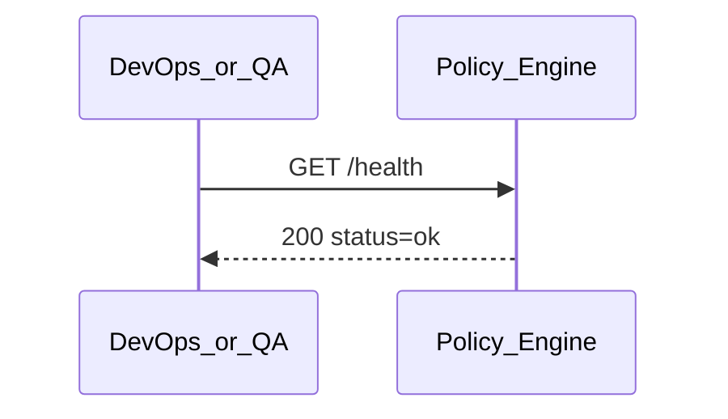

# Policy Engine Health Check

## 1. 기본 정보

| 항목 | 작성 내용 |
| --- | --- |
| API ID | `POL-API-001` |
| 기능명 | Policy Engine Health Check |
| Interface Type | Internal / Operations |
| Domain | Policy Engine |
| Caller | DevOps / QA / Compose Health Check |
| Owner | Policy Engine |
| Method | `GET` |
| Path | `/health` |
| Auth | `N/A` for local MVP; production `TBD` |
| Purpose | Policy Engine 프로세스가 요청을 처리할 수 있는지 확인한다. |

## 2. Request Header

| Header | Type | Required | 설명 | 예시 |
| --- | --- | --- | --- | --- |
| `Accept` | string | No | 응답 형식 | `application/json` |

## 3. Path Parameter

해당 없음.

## 4. Query Parameter

해당 없음.

## 5. Request Body

해당 없음.

## 6. Success Response

| Field | Type | Nullable | 설명 | 예시 |
| --- | --- | --- | --- | --- |
| `status` | string | No | 프로세스 상태 | `ok` |
| `service` | string | No | 서비스 식별자 | `policy-engine` |

```json
{
  "status": "ok",
  "service": "policy-engine"
}
```

## 7. Security Decision

`N/A`. 보안 판정을 수행하지 않는 운영 상태 확인 API다.

## 8. Error Contract

| HTTP | Error Code | 의미 | Retryable | 처리 |
| --- | --- | --- | --- | --- |
| `503` | `SERVICE_UNAVAILABLE` | 서버가 요청을 처리할 수 없음 | Yes | Container 상태 및 로그 확인 |

## 9. Side Effects

- DB 저장 / 수정: 없음
- Audit: 없음
- 다른 Component 호출: 없음
- 기타 상태 변경: 없음

## 10. Sequence



## 11. Open Questions / Assumptions

- [ ] Production 환경에서 인증을 적용할지 결정한다.
- [ ] Policy DB 연결 상태까지 포함하는 readiness endpoint가 필요한지 결정한다.

## 12. Related

- Dockerfile: `apps/policy/Dockerfile`
- Runtime: `compose.yaml`

## 13. Change Log

| Date | 변경 내용 | 작성자 |
| --- | --- | --- |
| 2026-08-20 | 현재 FastAPI 구현 기준 상세 명세 작성 | Codex |
