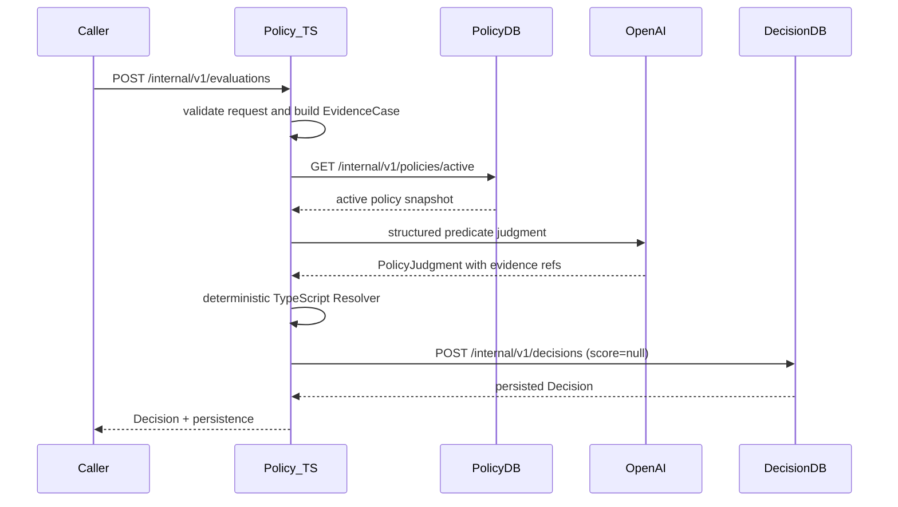

# Policy Evaluation API v0.1

## Endpoint

```text
POST /internal/v1/evaluations
```

Scanner가 보내는 요청 envelope와 응답의 Decision vocabulary는 유지한다. Policy 내부는 TypeScript로 실행하며 score 계산은 하지 않는다.

## Request

필수 필드는 `requestId`, `scanStatus`, `scanId`, `subject`, `evidences`, `osvFeed`다. `score`는 nullable deprecated field다. `LLM_ASSESSMENT`는 원 Evidence ID와 provenance 참조가 유효해야 한다.

## Response

기존 필드를 유지하며 `score`는 `null`이다.

```json
{
  "decisionId": "dec_123",
  "requestId": "req_123",
  "score": null,
  "decision": "HOLD",
  "reasonCode": "POLICY_DECISIVE_EVIDENCE_UNKNOWN",
  "reason": "A decisive policy condition is unresolved.",
  "matchedRuleIds": ["MALWARE-UNRESOLVED-001"],
  "evidenceIds": ["atomic-1", "llm:analysis-1:A-1"],
  "scanId": "scan_123",
  "policyVersion": "2.0.0",
  "judgmentId": "judgment-001",
  "subject": {},
  "evaluatedAt": "2026-09-20T00:00:00Z",
  "persistence": {"saved": true, "status": "SAVED", "decisionDbId": "..."}
}
```

## Sequence


