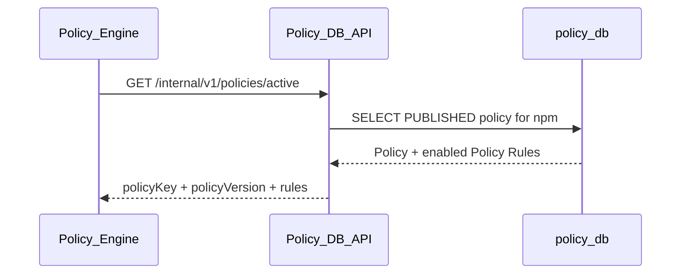

# Active Policy API Dependency

## 1. 기본 정보

| 항목 | 작성 내용 |
| --- | --- |
| API ID | `POL-API-003` |
| 기능명 | Active Policy 조회 |
| Interface Type | Internal Service Dependency |
| Domain | Policy DB |
| Caller | Policy Engine |
| Owner | Policy DB API |
| Method | `GET` |
| Path | `{POLICY_DB_URL}/internal/v1/policies/active` |
| Auth | `TBD` |
| Purpose | 현재 ecosystem에서 사용 중인 Published Policy와 활성 Rule을 반환한다. |

## 2. Request Header

| Header | Type | Required | 설명 | 예시 |
| --- | --- | --- | --- | --- |
| `Accept` | string | No | JSON 응답 요청 | `application/json` |
| 인증 Header | `TBD` | `TBD` | 서비스 인증 방식 미정 | `TBD` |

## 3. Path Parameter

해당 없음.

## 4. Query Parameter

해당 없음. 현재 결정된 정책 구조에서는 Policy DB가 ecosystem별 active Policy를 하나만 반환한다.

## 5. Request Body

해당 없음.

## 6. Success Response

| Field | Type | Nullable | 설명 | 예시 |
| --- | --- | --- | --- | --- |
| `policyKey` | string | No | 적용 Policy 논리명 | `npm-default` |
| `policyVersion` | string | No | 적용 Policy Version | `1.0.0` |
| `ecosystem` | string | No | 대상 생태계 | `npm` |
| `rules` | object[] | No | 활성 Policy Rule 목록 | `[]` |

Policy DB는 `policies.status = 'PUBLISHED'`인 row를 반환하고, `policy_rules.enabled = TRUE`인 Rule만 포함한다.

```json
{
  "policyKey": "npm-default",
  "policyVersion": "1.0.0",
  "ecosystem": "npm",
  "rules": [
    {
      "ruleId": "CR-001",
      "decision": "REJECT",
      "priority": 100,
      "reasonCode": "INSTALL_SCRIPT_REMOTE_EXECUTION",
      "reason": "An install script fetches remote content and executes a process.",
      "conditions": {
        "when": {
          "allOf": [
            {"predicate": "LIFECYCLE_TRIGGERED"},
            {"predicate": "DATA_REACHES_PROCESS_EXECUTION"}
          ]
        },
        "minimumSupport": "SUPPORTED",
        "onUnknown": "HOLD"
      }
    }
  ]
}
```

## 7. Security Decision

`N/A`. Policy DB API는 정책을 반환하며 Security Decision은 Policy Engine이 생성한다.

## 8. Error Contract

| HTTP | Error Code | 의미 | Retryable | Policy Engine 처리 |
| --- | --- | --- | --- | --- |
| `404` | `ACTIVE_POLICY_NOT_FOUND` | Published Policy가 없음 | No | 운영 설정 오류로 처리 |
| `5xx` | `POLICY_DB_ERROR` | Policy DB 내부 오류 | Yes | `POLICY_DB_UNAVAILABLE`로 매핑 가능 |
| `200` | `POLICY_INVALID` | 응답 JSON이 Contract와 다름 | No | `POLICY_DB_INVALID_RESPONSE` |

## 9. Side Effects

- DB 저장 / 수정: 없음
- Audit: Policy DB 운영 정책에 따름
- 다른 Component 호출: Policy DB PostgreSQL 내부 조회
- 기타 상태 변경: 없음

## 10. Sequence



## 11. Open Questions / Assumptions

- [ ] Policy DB API의 실제 Host, Port, Auth를 확정한다.
- [ ] `PUBLISHED` Policy가 없을 때 HTTP status를 확정한다.
- [ ] Policy Version 변경 시 기존 Published row를 Archive하는 운영 절차를 확정한다.

## 12. Related

- Policy DB Migration: `infra/postgres/migrations/policy/001_initial.sql`
- Policy Contract: `packages/contracts/policy-v0.1.schema.json`
- Client: `apps/policy/src/policy/active-policy.client.ts`

## 13. Change Log

| Date | 변경 내용 | 작성자 |
| --- | --- | --- |
| 2026-08-20 | Policy DB active policy 의존성 상세 명세 작성 | Codex |
