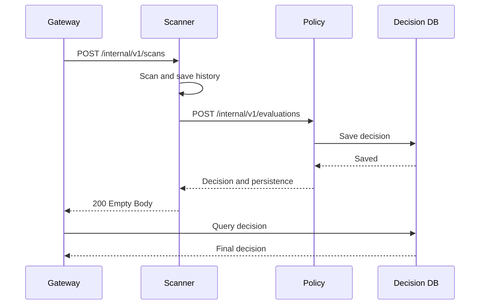

# Policy Evaluation Request

> **계약 상태: PARTIALLY_CONFIRMED**
>
> 현재 `policy-evaluation-v0.1.schema.json`과 Policy Runtime은 `scanStatus`, `scanId`,
> 최상위 `subject`, 빈 `evidences`와 엄격한 Evidence 구조를 지원한다. 다만 Gateway의
> Decision 재조회에 필요한 SHA-512 `integrity` 전달 계약은 아직 없으므로, 해당 필드와
> Decision DB Mapping을 확정하기 전에는 전체 Integration을 완료할 수 없다.
>
> 이 문서는 Scanner가 Package별 분석 결과를 Policy Engine에 전달하고, Policy의
> Decision DB 저장 완료를 확인하기 위한 내부 Interface 계약을 정의한다.
>
> Gateway는 이 Interface의 응답을 직접 받지 않는다. Scanner의 최종 `200` 완료
> 응답을 받은 뒤 Decision DB를 재조회한다.

## 1. 기본 정보

| 항목 | 작성 내용 |
| --- | --- |
| API ID | `SCN-API-005` |
| 기능명 | Policy Evaluation Request |
| Interface Type | `Internal` |
| Domain | `Policy` |
| Caller | `Scanner` |
| Owner | `Policy Engine` |
| Method | `POST` |
| Path | `/internal/v1/evaluations` |
| Contract Version | 현재 `policy-evaluation-v0.1`; `subject.integrity` 추가 시 v0.2 검토 |
| Auth | `TBD`; local MVP는 별도 인증 없음 |
| Timeout | `TBD`; Scanner 전체 처리 Budget 안에서 확정 필요 |
| Purpose | Scanner가 Package별 `ScanResult`의 상태·Subject·Atomic Evidence를 Policy Engine에 전달하고, 최종 Decision의 Decision DB 저장 완료를 확인한다. |

확정된 전체 호출 구조는 다음과 같다.

```text
Gateway
→ Scanner
→ Policy Engine
→ Decision DB
← Scanner가 저장 완료 확인
← Gateway에 HTTP 200 빈 Body
→ Gateway가 Decision DB 재조회
```

Scanner는 Evidence 생성까지 담당한다. Score 계산, Policy Rule 평가, Security
Decision 생성 및 Decision DB 저장은 Policy Engine의 책임이다.

남은 Contract 변경은 다음 순서로 처리한다.

```text
Hash·Integrity Contract 확정
→ 공용 Policy Evaluation Schema·Policy Model 반영
→ Decision DB Mapping Contract Test
→ Scanner Mapper·HTTP Client 구현
```

## 2. Request Header

Scanner와 Policy Engine 간 내부 JSON 통신에 사용한다.

| Header | Type | Required | 설명 | 예시 |
| --- | --- | --- | --- | --- |
| `Content-Type` | string | Yes | Request Body 형식 | `application/json` |
| `Accept` | string | Yes | 기대 Response 형식 | `application/json` |
| `Authorization` | string | TBD | 내부 서비스 인증 방식 확정 시 사용 | `Bearer <token>` |

인증 방식이 확정되기 전에는 인증 Header를 임의로 추가하지 않는다. 요청 Header에
Registry 인증정보, Tarball URL 또는 사용자 입력 Header를 전달하지 않는다.

## 3. Path Parameter

Path Parameter를 사용하지 않는다.

| Key | Type | Required | 설명 | 예시 |
| --- | --- | --- | --- | --- |
| N/A | - | - | Path Parameter 없음 | - |

## 4. Query Parameter

Query Parameter를 사용하지 않는다.

| Key | Type | Required | Nullable | 설명 | 예시 |
| --- | --- | --- | --- | --- | --- |
| N/A | - | - | - | Query Parameter 없음 | - |

## 5. Request Body

Scanner는 Batch 전체를 한 번에 평가하지 않고 Package별 `ScanResult`마다 Policy
Evaluation을 한 번 호출한다.

| Field | Type | Required | Nullable | 설명 | 예시 |
| --- | --- | --- | --- | --- | --- |
| `requestId` | UUID string | Yes | No | Gateway가 생성하고 전체 처리 흐름에서 유지하는 Request ID | `f44203a5-0f44-43ba-8481-34ca77608578` |
| `scanStatus` | enum | Yes | No | Scanner의 Package별 상태: `COMPLETED`, `PARTIAL`, `FAILED`, `TIMEOUT` | `COMPLETED` |
| `scanId` | UUID string | Yes | No | Scanner가 Package별로 생성한 Scan ID | `26c0a4ba-b0de-4b67-9588-42d13eff5036` |
| `subject` | object | Yes | No | 평가 대상 npm Package와 검증된 Artifact Identity | `{...}` |
| `evidences` | `EvidenceV0_1[]` | Yes | No | Scanner가 정규화한 Atomic Evidence 목록; 정상 미탐지는 빈 배열 허용 | `[]` |

Scanner는 Score를 계산하지 않으므로 `score`를 전송하지 않는다.
`expectedArtifactHash`도 의미와 canonical 형식이 확정되지 않았으므로 이 Scanner 전용
계약에는 포함하지 않는다. 공용 Policy API가 다른 Caller를 위해 두 필드를 유지하더라도
Scanner는 두 필드를 전송해서는 안 된다.

### `subject`

| Field | Type | Required | Nullable | 설명 | 예시 |
| --- | --- | --- | --- | --- | --- |
| `ecosystem` | enum | Yes | No | MVP에서는 `npm` | `npm` |
| `packageName` | string | Yes | No | 검증된 Package Name | `example-package` |
| `packageVersion` | string | Yes | No | 검증된 exact Package Version | `1.0.0` |
| `artifactHash` | string | Yes | No | Scanner와 Evidence가 사용하는 lowercase SHA-256 hex | `aaaaaaaa...` |

`subject`와 모든 `evidences[].subject`는 `ecosystem`, `packageName`,
`packageVersion`, `artifactHash`가 같아야 한다. `scanId`도 각 Evidence의
`provenance.scanId`와 같아야 한다.

### 필요한 Contract 확장: `subject.integrity`

현재 v0.1 Schema에는 `integrity`가 없고 `additionalProperties: false`이므로 Scanner가
이를 전송하면 Policy가 `422`를 반환한다. Gateway 재조회까지 연결하려면 다음 필드를
공용 Contract와 Policy·Decision Model에 먼저 추가해야 한다.

| Field | Type | Required | Nullable | 설명 | 예시 |
| --- | --- | --- | --- | --- | --- |
| `subject.integrity` | string | Yes | No | 실제 Tarball Byte에서 계산한 canonical SHA-512 SRI; Gateway 재조회 Key | `sha512-<base64>` |

`integrity`는 Policy Evaluation 최상위 Subject에만 추가하고 Evidence Subject의
`artifactHash`를 대체하지 않는다. Contract 반영 전에는 이 필드를 요청에 포함하지
않는다.

`COMPLETED + evidences: []`는 정상 미탐지를 의미한다. `PARTIAL + evidences: []`는
일부 Analyzer가 실패·Timeout·Skip되었거나 정규화가 불완전하여 전체 분석 완전성을
보장할 수 없으며, 정상 완료된 분석에서 생성된 Evidence가 없는 상태를 의미한다.
Policy는 두 경우를 `scanStatus`로 구분한다.

### Policy 호출 가능 조건

Policy Evaluation은 검증된 Artifact Identity와 Hash·Integrity를 확보한 Package에만
호출한다.

| Scanner 결과 | Policy 호출 |
| --- | --- |
| `COMPLETED` | 호출 |
| `PARTIAL`, Artifact 검증 완료 | 호출 |
| Analyzer `FAILED/TIMEOUT`, Artifact 검증 완료 | 호출 가능; `scanStatus`로 불완전 상태 전달 |
| Registry Metadata·Download·Extract·Identity 실패 | 호출하지 않음 |
| Integrity 불일치 | 호출하지 않음; 불일치 Artifact를 정상 Subject로 평가 금지 |

Artifact Identity 확보 전에 실패하면 Policy Decision을 생성하지 않고 Scanner는
Gateway에 성공 `200`을 반환하지 않는다. 이 실패를 Policy `REJECT`로 변환하지 않는다.

### Scanner `ScanResult` Mapping

| Scanner `ScanResult` | Policy Evaluation Request |
| --- | --- |
| `requestId` | `requestId` |
| `status` | `scanStatus` |
| `scanId` | `scanId` |
| `subject.ecosystem` | `subject.ecosystem` |
| `subject.name` | `subject.packageName` |
| `subject.version` | `subject.packageVersion` |
| `artifactHash` | `subject.artifactHash` |
| 다운로드 중 계산한 `calculatedIntegrity` | `subject.integrity`; Contract 확장 후 |
| `evidences` | `evidences` |

`analyzerSummaries`, `ScanResult.errors`, Registry Metadata, Normalization Summary,
Unmapped Finding 상세와 임시 파일 경로는 Policy 요청에 추가하지 않는다.

### Request Example

```json
{
  "requestId": "f44203a5-0f44-43ba-8481-34ca77608578",
  "scanStatus": "COMPLETED",
  "scanId": "26c0a4ba-b0de-4b67-9588-42d13eff5036",
  "subject": {
    "ecosystem": "npm",
    "packageName": "example-package",
    "packageVersion": "1.0.0",
    "artifactHash": "aaaaaaaaaaaaaaaaaaaaaaaaaaaaaaaaaaaaaaaaaaaaaaaaaaaaaaaaaaaaaaaa"
  },
  "evidences": [
    {
      "schemaVersion": "0.1",
      "evidenceId": "e46a91b7-bbaf-479d-a8e7-d8bb71258741",
      "kind": "ATOMIC",
      "signal": {
        "id": "capability.lifecycle.postinstall",
        "type": "POSTINSTALL_SCRIPT",
        "category": "METADATA"
      },
      "subject": {
        "ecosystem": "npm",
        "packageName": "example-package",
        "packageVersion": "1.0.0",
        "artifactHash": "aaaaaaaaaaaaaaaaaaaaaaaaaaaaaaaaaaaaaaaaaaaaaaaaaaaaaaaaaaaaaaaa"
      },
      "assertion": {
        "summary": "A postinstall lifecycle script is declared in package metadata.",
        "basis": "METADATA_VALUE"
      },
      "sources": [
        {
          "analyzer": "metadata",
          "analyzerVersion": "0.1.0",
          "ruleId": "metadata.lifecycle.postinstall",
          "rawFindingId": "finding-001"
        }
      ],
      "locations": [
        {
          "type": "METADATA",
          "path": "package.json",
          "jsonPointer": "/scripts/postinstall"
        }
      ],
      "provenance": {
        "scanId": "26c0a4ba-b0de-4b67-9588-42d13eff5036",
        "generatedBy": "EVIDENCE_NORMALIZER",
        "observedAt": "2026-08-26T00:00:00Z"
      },
      "limitations": [
        "Lifecycle script presence does not prove that the script was executed."
      ]
    }
  ]
}
```

현재 Source of Truth는 `packages/contracts/policy-evaluation-v0.1.schema.json`과
`packages/contracts/evidence-v0.1.schema.json`이다. 위 Request Example은 현재 v0.1
Schema와 Policy Model이 허용하는 구조다. `subject.integrity`를 포함한 요청은 공용
Contract와 Policy Runtime이 함께 변경된 이후에만 전송한다.

## 6. Success Response

Policy Engine은 평가와 Decision DB 저장을 모두 완료한 후 `200`과 Decision을
반환한다. Scanner는 응답을 `unknown`으로 받고 최소 필드와 요청 Identity를
검증한다.

| Field | Type | Nullable | 설명 | 예시 |
| --- | --- | --- | --- | --- |
| `decisionId` | string | No | 비어 있지 않은 opaque Decision 식별자; Scanner는 내부 형식을 해석하지 않음 | `decision-001` |
| `requestId` | string | No | 요청의 `requestId`와 일치해야 함 | `f44203a5-0f44-43ba-8481-34ca77608578` |
| `score` | number | No | Policy의 최종 평가 Score | `75` |
| `decision` | enum | No | `ACCEPT`, `REJECT`, `HOLD`, `REVIEW` | `ACCEPT` |
| `reasonCode` | string | No | 최종 판단 사유 Code | `SCORE_ACCEPT` |
| `reason` | string | No | 안전하게 외부 전달 가능한 판단 사유 | `No blocking policy rule matched.` |
| `matchedRuleIds` | string[] | No | 적용된 Scoring·Policy Rule ID | `[]` |
| `evidenceIds` | string[] | No | 평가에 사용한 Evidence ID | `[...]` |
| `scanId` | string | No | 요청의 `scanId`와 일치해야 함 | `26c0a4ba-b0de-4b67-9588-42d13eff5036` |
| `policyVersion` | string | No | 적용한 Policy Version | `0.1.0` |
| `subject` | object | No | 요청 Subject와 일치해야 함 | `{...}` |
| `evaluatedAt` | datetime string | No | Policy 평가 시각 | `2026-08-26T00:00:01Z` |
| `persistence` | object | No | Decision DB 저장 결과 | `{...}` |

### `persistence`

| Field | Type | Nullable | 설명 | 예시 |
| --- | --- | --- | --- | --- |
| `saved` | boolean | No | `true`인 경우에만 저장 완료 | `true` |
| `status` | enum | No | `SAVED`, `ALREADY_EXISTS` | `SAVED` |
| `decisionDbId` | UUID string | Yes | Decision DB Record ID | `f1f2b3f0-12e6-46e1-9589-961cc893aa90` |

### Response Example

```json
{
  "decisionId": "decision-001",
  "requestId": "f44203a5-0f44-43ba-8481-34ca77608578",
  "score": 75,
  "decision": "ACCEPT",
  "reasonCode": "SCORE_ACCEPT",
  "reason": "No blocking policy rule matched.",
  "matchedRuleIds": [],
  "evidenceIds": ["e46a91b7-bbaf-479d-a8e7-d8bb71258741"],
  "scanId": "26c0a4ba-b0de-4b67-9588-42d13eff5036",
  "policyVersion": "0.1.0",
  "subject": {
    "ecosystem": "npm",
    "packageName": "example-package",
    "packageVersion": "1.0.0",
    "artifactHash": "aaaaaaaaaaaaaaaaaaaaaaaaaaaaaaaaaaaaaaaaaaaaaaaaaaaaaaaaaaaaaaaa"
  },
  "evaluatedAt": "2026-08-26T00:00:01Z",
  "persistence": {
    "saved": true,
    "status": "SAVED",
    "decisionDbId": "f1f2b3f0-12e6-46e1-9589-961cc893aa90"
  }
}
```

Scanner는 HTTP `2xx`만으로 완료 처리하지 않는다. `requestId`, `scanId`, `subject`,
`decision`, `evidenceIds`와 `persistence.saved === true`를 검증한다. 검증이 끝난 뒤
Decision을 Gateway에 전달하지 않고, 기존 `POST /internal/v1/scans`의 빈 Body `200`
응답만 반환한다.

`subject.integrity` Contract가 추가되면 Policy 응답 Subject에도 요청과 동일한
`integrity`를 보존하고 Scanner가 일치 여부를 검증해야 한다.

`response.evidenceIds`의 모든 값은 요청한 `evidences[].evidenceId`에 존재해야 한다.
요청에 없던 Evidence ID가 응답에 포함되면 응답 검증 실패다. Policy가 평가에서 일부
Evidence만 선택할 수 있으므로 전체 배열의 완전 일치는 Policy Contract가 별도로
요구하기 전까지 강제하지 않는다.

## 7. Security Decision

Security Decision 생성 주체는 Policy Engine이다. Scanner는 Decision을 생성하거나
Decision 값에 따라 Gateway 응답을 바꾸지 않는다.

| Decision | 의미 | Scanner / Gateway 후속 행동 |
| --- | --- | --- |
| `ACCEPT` | Package 사용 허용 | Scanner 저장 완료 확인 후 `200`; Gateway가 Decision DB 재조회 |
| `REJECT` | Package 사용 차단 | Scanner 저장 완료 확인 후 `200`; Gateway가 재조회하여 차단 |
| `HOLD` | 추가 처리 또는 조건 충족 전 보류 | Scanner 저장 완료 확인 후 `200`; Gateway가 재조회하여 보류 |
| `REVIEW` | 수동 검토 필요 | Scanner 저장 완료 확인 후 `200`; Gateway가 재조회하여 검토 Workflow 수행 |

`REJECT`도 정상적인 Policy 평가·저장 성공이다. Scanner는 `REJECT`를 HTTP 오류로
변환하지 않는다. 반대로 Policy 통신·평가·저장 실패를 `REJECT`로 변환하지 않는다.

## 8. Error Contract

Policy가 현재 구현에서 반환하는 오류와 Scanner가 식별해야 하는 연동 오류를 구분한다.

| HTTP / 조건 | Error Code | 의미 | Retryable | Scanner 처리 |
| --- | --- | --- | --- | --- |
| `422` | Framework validation error | Request 또는 Evidence Contract 불일치 | No | 성공 처리 금지, Contract 점검 |
| `422` | `MULTIPLE_SUBJECTS` | 한 Evaluation에 서로 다른 Subject 포함 | No | Package별 요청·Subject Mapping 점검 |
| `422` | `INVALID_CORRELATED_EVIDENCE` | Correlated Evidence에 `derivedFrom` 누락 | No | Evidence Contract 수정; 초기 Scanner는 Correlated Evidence 미생성 |
| `422` | `DECISION_DB_INVALID_REQUEST` | Policy가 생성한 Decision을 Decision DB가 거부 | No | Policy·Decision Contract 점검 |
| `502` | `POLICY_DB_INVALID_RESPONSE` | Policy DB 응답 Contract 불일치 | No | Policy DB 응답·버전 점검 |
| `502` | `DECISION_DB_INVALID_RESPONSE` | Decision DB 저장 응답 Contract 불일치 | No | Decision DB 응답 점검 |
| `503` | `POLICY_DB_UNAVAILABLE` | Active Policy 조회 실패 | Yes | Scanner 성공 처리 금지; 자동 Retry 없음 |
| `503` | `DECISION_DB_UNAVAILABLE` | Decision DB 저장 실패 | Yes | Scanner 성공 처리 금지; 자동 Retry 없음 |
| 연결 실패 | Scanner 내부 연동 오류 | Policy에 연결할 수 없음 | Yes | Scanner `200` 반환 금지 |
| Scanner timeout | Scanner 내부 연동 오류 | Policy 응답 제한시간 초과 | Yes | 요청 취소, Scanner `200` 반환 금지 |
| 응답 Parse·Identity·크기 오류 | Scanner 내부 연동 오류 | Policy 응답을 신뢰할 수 없음 | No | Scanner `200` 반환 금지 |
| `persistence.saved !== true` | Scanner 내부 연동 오류 | Decision 저장 완료를 확인하지 못함 | No | Scanner `200` 반환 금지 |

Scanner 전용 Policy Error Code와 Stage는 기존 Scanner 공통 Error Contract에서 표현
가능한지 확인한 뒤 확정한다. 명세에 없는 Error Code를 구현 중 임의로 추가하지 않는다.

Policy 호출·평가·저장 실패는 이미 생성된 `ScanResult.status`를 변경하지 않는다.
예를 들어 분석이 완료된 뒤 Policy 연결만 실패했다면 `ScanResult.status`는
`COMPLETED`이고 Policy Delivery 상태는 `FAILED`다. 분석 실패와 Component 연동 실패를
같은 상태로 합치지 않는다.

Scanner는 자동 Retry를 수행하지 않는다. Policy가 Decision을 저장한 뒤 응답만
유실되면 새 `decisionId`로 중복 저장될 수 있으므로 Retry 전에 `scanId` 또는 Artifact
Identity 기반 Idempotency 계약을 확정해야 한다.

Error Body, 내부 Stack Trace, 전체 Header, Evidence 원문과 민감 URL은 Scanner 오류
메시지나 Gateway 응답에 그대로 포함하지 않는다.

## 9. Side Effects

- Scanner DB 변경: 없음
- Scanner History: Policy 호출 전에 생성된 Package별 `ScanResult`를 기존 History에 저장
- Policy DB 조회: Policy Engine이 active Policy를 조회
- Decision DB 저장: Policy Engine이 최종 Decision을 저장
- Scanner 완료 시점: 요청된 모든 Package의 Decision 저장 완료를 검증한 이후
- Gateway 응답: 기존 `POST /internal/v1/scans`의 `200` 빈 Body 유지
- Gateway 후속 처리: Scanner 성공 응답 이후 `packageName/version/integrity`로 Decision DB 재조회
- 자동 Retry: 없음
- Policy Decision의 Scanner History 저장: 이번 범위에서 제외
- Policy Delivery 실패 기록 위치: `TBD`; ScanResult 상태와 분리된 구조화 기록 필요

Scanner의 Evidence Normalization은 이 API 호출 전에 완료된다. 이 Interface 자체가
`ScanResult`를 Evidence로 변환하지 않는다.

## 10. Sequence



Package 하나의 Policy 평가가 실패해도 Deadline이 남아 있으면 나머지 Package 처리를
계속한다. 모든 Package 처리 후 하나라도 Decision 저장에 실패했으면 Scanner는 성공
`200`을 반환하지 않는다. 먼저 성공한 Package의 Decision은 Rollback하지 않는다.
전체 Deadline이 부족하면 새로운 Package 처리를 시작하지 않고 timeout 실패로
집계한다.

## 11. Open Questions / Assumptions

### 확정 사항

- Policy Caller는 Scanner다.
- Policy Endpoint는 `POST /internal/v1/evaluations`다.
- Scanner는 Package별로 Policy를 한 번 호출한다.
- Policy Engine이 최종 Decision 생성과 Decision DB 저장을 담당한다.
- Scanner는 `persistence.saved=true`를 확인한 뒤에만 해당 Package를 완료 처리한다.
- 모든 Package 저장 완료 후 Gateway에 `200` 빈 Body를 반환한다.
- Package 하나의 Policy 실패가 다른 Package 처리를 즉시 중단시키지 않는다.
- 하나라도 저장 실패하면 Batch 성공 `200`을 반환하지 않는다.
- Gateway는 Scanner Response Body에 의존하지 않고 Decision DB를 재조회한다.
- Policy 통신 실패는 Operational Error이며 `REJECT`로 변환하지 않는다.
- 자동 Retry는 구현하지 않는다.

### 현재 반영 확인

| 항목 | 상태 | 근거 |
| --- | --- | --- |
| `scanStatus`, `scanId`, 최상위 `subject` | 반영 완료 | Policy Evaluation v0.1 Schema·Pydantic Model |
| 빈 `evidences` | 반영 완료 | Schema에 `minItems` 없음, Model default 빈 배열, Policy 테스트 |
| `COMPLETED + []` | 반영 완료 | Policy 테스트에서 `ACCEPT` 검증 |
| `PARTIAL + []` | 반영 완료 | Policy 테스트에서 `HOLD` 검증 |
| Evidence 내부 엄격 검증 | 반영 완료 | 공용 Evidence Schema와 Policy Model |
| `PREINSTALL_SCRIPT`, `INSTALL_SCRIPT` | Policy 반영 완료 | Policy Scoring 상수와 테스트 |
| 중복 Signal 점수 처리 | Policy 반영 완료 | 기본점수 중복 제거·Analyzer corroboration 테스트 |
| Policy의 Decision DB 저장·`persistence` | 반영 완료 | Policy Runtime과 테스트 |

### 남은 Contract Blocker

- `subject.integrity`가 Policy Evaluation v0.1 Schema·Model에 없다.
- Decision Model이 `subject.integrity`를 `artifact_hash_512`로 저장하지 않는다.
- 현재 Scanner `artifactHash`는 접두사 없는 SHA-256 hex이므로 Decision DB의 legacy
  `artifactHash` validator가 그대로 받아들이지 못할 수 있다.
- 기존 Policy API 문서의 Caller·저장 Sequence 일부는 현재 Runtime과 다르다.

### 결정 필요

- `policy-evaluation-v0.2` 공용 Contract의 최종 필드와 버전 전환 방식
- Policy Pydantic Model·JSON Schema 동기화 범위
- `POLICY_URL` 환경변수 이름과 기본값
- Scanner 전체 Deadline과 Policy Evaluation timeout
- Batch 최대 크기 및 Deadline 소진 시 중단 기준
- Scanner ↔ Policy 내부 Auth 방식
- Scanner Policy 연동 Error Code와 Stage
- timeout 또는 응답 유실 후 중복 Decision을 막을 Idempotency Key
- Policy Delivery 실패의 구조화 기록 위치
- Artifact 검증 실패 시 Gateway에 반환할 HTTP 오류
- Policy Decision을 Scanner History에도 남길지 여부

### Artifact Hash / Decision 재조회 정합성

Gateway의 Decision 조회는 `packageName/version/integrity`를 사용하고, 현재 Decision DB
구현은 조회 `integrity`를 `artifact_hash_512`와 정확히 비교한다. v0.2 목표 계약은
다음 의미를 분리한다.

| 필드 | 의미 |
| --- | --- |
| `artifactHash` | Scanner·Evidence가 사용하는 lowercase SHA-256 hex |
| `integrity` | 실제 Tarball Byte에서 계산한 canonical SHA-512 SRI |
| `expectedIntegrity` | Gateway 또는 Registry가 제시한 예상 SRI; Policy 요청에는 미포함 |

Decision DB의 `artifact_hash_512`에는 `subject.integrity`를 저장한다. Downloader가 이미
계산한 `calculatedIntegrity`를 Orchestrator·ScanResult 이후 Policy Mapper까지 손실 없이
전달해야 한다. `artifactHash` 하나를 SHA-256과 SHA-512 의미로 번갈아 사용하지 않는다.

## 12. Related

- Scanner 구현 계획:
  - `Scanner Policy Integration Implementation Plan.md`
- Request Contract:
  - 현재: `../../../packages/contracts/policy-evaluation-v0.1.schema.json`
  - 목표: `policy-evaluation-v0.2.schema.json` 제안; 아직 생성되지 않음
- Evidence Contract:
  - `../../../packages/contracts/evidence-v0.1.schema.json`
- Scanner Domain:
  - `../src/domain/analysis.types.ts`
- Scanner Controller:
  - `../src/api/scan.controller.ts`
- Policy Runtime:
  - `../../policy/app/main.py`
  - `../../policy/app/models.py`
- Decision DB Runtime:
  - `../../policy/app/decision_db_api.py`
- Architecture / Workflow:
  - `ScanResult → Policy Evaluation → Decision DB`
  - `Gateway → Scanner → Policy → Decision DB → Scanner → Gateway`
  - `Gateway → Decision DB Re-query`
- QA:
  - 정상 Evidence 및 빈 Evidence 평가
  - `ACCEPT`, `REJECT`, `HOLD`, `REVIEW` Decision 저장
  - 요청·응답 Identity 불일치
  - Policy·Policy DB·Decision DB 장애 및 timeout
  - 저장 완료 전 Scanner 성공 응답 차단
  - 저장 완료 후 Scanner `200` 빈 Body
  - Gateway Decision DB 재조회와 Integrity 일치

## 13. Change Log

| Date | 변경 내용 | 작성자 |
| --- | --- | --- |
| 2026-08-25 | 기존 ScanResult Delivery 항목을 Policy Evaluation Request 초안으로 재정의 | 김혜진 |
| 2026-08-26 | Scanner Caller, Policy의 Decision DB 저장, Gateway 재조회 구조를 확정 흐름으로 반영 | Codex |
| 2026-08-26 | 실제 Evidence·Decision 응답, 저장 완료 검증, 빈 Evidence·Scan Status 및 Artifact Hash Gap 반영 | Codex |
| 2026-08-26 | v0.2 목표안 상태, Hash·Integrity 분리, 호출 가능 조건, Batch 격리와 상태·응답 검증 기준 반영 | Codex |
| 2026-08-26 | 공용 v0.1의 Scan Context·빈 Evidence·엄격 검증 반영 상태를 재확인하고 남은 Integrity 확장만 Blocker로 정정 | Codex |
