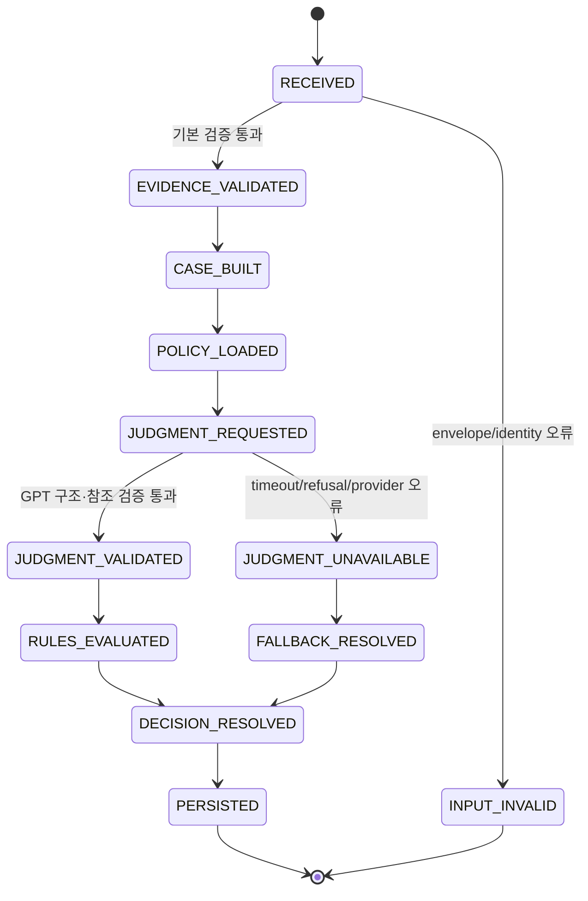

# Policy LLM_ASSESSMENT 판단 워크플로우

작성일: 2026-09-20
상태: 재설계 제안
기준: `origin/dev` `7f4a40a`
범위: Scanner가 보내는 기존 Policy Evaluation 요청·수신 경계를 유지하고, Policy 내부를 TypeScript 기반 Evidence 판단 구조로 교체한다.

## 1. 재설계의 결정

Policy는 더 이상 숫자 risk score를 계산해 결정을 내리지 않는다. Policy의 최종 권한은 유지하되, 입력된 `LLM_ASSESSMENT`와 원 Evidence를 정책 조건에 대입해 판단한다.

최종 구조는 다음이다.

```text
Scanner
  └─ Atomic / Correlated Evidence
  └─ LLM_ASSESSMENT
  └─ OSV Feed
          │
          ▼
Policy Evaluation API (기존 요청·수신 경계 유지)
          │
          ├─ 입력·identity·Evidence 무결성 검증
          ├─ Evidence Case 구성
          ├─ Active Policy 로드
          ├─ GPT Policy Adjudicator
          ├─ GPT 결과의 결정적 검증
          ├─ TypeScript Policy Rule Resolver
          ├─ 최종 Decision 생성
          └─ Decision DB 저장
```

역할은 분리한다.

| 구성요소 | 책임 | 하지 않는 일 |
| --- | --- | --- |
| Scanner LLM | 코드 조각과 Scanner Evidence에서 기술적 행위 Assessment 생성 | Policy Decision 생성 |
| Policy GPT | 받은 Assessment가 정책 조건을 만족하는지, 근거가 충분한지, 반대 근거가 있는지 평가 | 새 코드 실행, 새 사실 생성, 정책 우회 |
| TypeScript Policy Resolver | Policy 규칙·우선순위·불확실성·실패 모드를 적용해 최종 결정 | GPT 문장을 그대로 결정으로 복사 |
| Decision DB | 최종 Decision과 판단 추적 정보 저장 | Evidence의 의미 재해석 |

`LLM_ASSESSMENT`는 Policy가 받는 핵심 파생 근거다. 그러나 `intentAssessment`, `confidence`, 상류 `summary.verdict`를 사실이나 숫자 점수로 간주하지 않는다. 반드시 연결된 Atomic/Correlated Evidence와 참조 무결성을 확인한 뒤 정책 판단에 사용한다.

## 2. 유지할 외부 경계와 버릴 내부 경로

### 유지

- Scanner가 호출하는 `POST /internal/v1/evaluations` endpoint
- `requestId`, `scanStatus`, `scanId`, `subject`, `evidences`, `osvFeed`의 요청 흐름
- Policy가 Decision을 생성하고 Decision DB에 저장하는 책임
- Scanner가 `persistence.saved`를 확인한 후 완료 처리하는 흐름
- `ACCEPT`, `REJECT`, `HOLD`, `REVIEW` Decision vocabulary

### 교체

- Python Policy runtime을 TypeScript Policy runtime으로 교체
- `score_evidences`, `SIGNAL_RISK_POINTS`, `scoreGte`, `scoreLt` 기반 판단 제거
- Signal 위험도 합산 및 `100 - detectionScore` 계산 제거
- GPT confidence를 score로 변환하는 경로 금지
- `LLM_ASSESSMENT`를 단순한 추가 점수로 합산하는 경로 금지

요청 호환 때문에 기존 wire payload에 `score`가 남아야 한다면 입력은 nullable deprecated field로만 수용하고 무시한다. 새 TypeScript 내부 모델과 Decision 저장 모델에는 score를 판단 필드로 두지 않는다. 응답 호환이 반드시 필요하면 `score: null`을 한시적으로 반환하고, 실제 결정 근거는 `decision`, `reasonCode`, `matchedRuleIds`, `evidenceIds`, `judgmentId`로 표현한다.

`OSV Feed`는 유지하지만 위험 점수로 바꾸지 않는다. Advisory의 package/version 영향 여부와 Policy가 정한 `known-vulnerability` 조건을 평가하는 Evidence/외부 사실로 사용한다. GuardDog의 원 `risk_score`도 Policy 판단 입력으로 승격하지 않는다.

## 3. 수신 후 전체 상태 흐름



각 단계의 의미는 다음과 같다.

1. `RECEIVED`: HTTP 요청을 수신하고 request/scan/subject identity를 만든다.
2. `EVIDENCE_VALIDATED`: 모든 Evidence가 같은 artifact와 scan에 속하는지, ID가 유일한지, LLM 참조가 실제 Evidence/Finding을 가리키는지 확인한다.
3. `CASE_BUILT`: 관측 사실, 파생 Assessment, 코드 위치, provenance, coverage를 하나의 판단 Case로 묶는다.
4. `POLICY_LOADED`: Policy DB에서 version이 고정된 active Policy를 가져온다. GPT prompt에는 이 snapshot을 그대로 넣는다.
5. `JUDGMENT_REQUESTED`: Policy GPT가 정책 조건별 근거 평가를 만든다.
6. `JUDGMENT_VALIDATED`: GPT 출력의 schema, 참조, 정책 rule ID, 허용 status를 결정적으로 검증한다.
7. `RULES_EVALUATED`: TypeScript Resolver가 GPT 평가와 Policy 규칙을 적용한다.
8. `DECISION_RESOLVED`: 최종 결정과 사유·근거 ID·판단 ID를 만든다.
9. `PERSISTED`: Decision과 judgment audit record를 저장하고 기존 응답 형식으로 반환한다.

## 4. Evidence Case 구성

Policy GPT에 raw JSON 전체를 그대로 던지지 않고, 서버가 아래 Case를 만든다.

```text
PolicyCase
├─ identity
│  ├─ requestId / scanId
│  ├─ ecosystem / packageName / packageVersion
│  ├─ artifactHash / integrity
│  └─ policyVersion
├─ observations[]
│  ├─ ATOMIC / CORRELATED Evidence
│  ├─ signal / assertion / source / location
│  └─ provenance / limitations
├─ assessments[]
│  ├─ LLM_ASSESSMENT
│  ├─ related Atomic/Finding IDs
│  ├─ flow / reachability / alternatives
│  └─ producer model / prompt / analysis ID
├─ evidenceGraph
│  ├─ derivedFrom
│  ├─ supports
│  ├─ contradicts
│  └─ unresolved links
├─ coverage
│  ├─ scan status
│  ├─ agent status
│  ├─ missing context
│  └─ limitations
└─ policySnapshot
   ├─ policyVersion
   ├─ rules
   ├─ precedence
   └─ failure mode
```

Case Builder는 다음을 수행한다.

- `subject`와 각 Evidence의 subject가 동일한지 확인한다.
- `provenance.scanId`와 요청 `scanId`를 비교한다.
- `evidenceId`, `findingId`, `assessmentId`, `sliceId` 중복·미존재·교차 artifact 참조를 거부한다.
- `LLM_ASSESSMENT.relatedAtomicEvidenceIds`가 실제 받은 Evidence를 가리키는지 확인한다.
- `executionContext.flow`의 참조 ID가 실제 assessment refs와 연결되는지 확인한다.
- 상류 `verificationStatus: VERIFIED`를 “악성 의미가 검증됨”이 아니라 “Scanner의 구조·참조 검증을 통과함”으로 정규화한다.
- `confidence`는 품질 보조 정보로만 보존하고 policy threshold 계산에 쓰지 않는다.
- 같은 Atomic Evidence를 여러 Assessment가 참조하면 독립 증거 수를 늘리지 않는다.
- `agentAnalysisSummary.verdict`는 GPT의 결론을 미리 정하는 값으로 전달하지 않고 audit용 metadata로 보존한다.

Policy Case가 만들어지기 전에 입력이 깨지면 GPT를 호출하지 않는다. 입력 오류는 `422`로, Policy/DB 운영 장애는 기존 operational error 흐름으로 분리한다.

## 5. Policy 문서 구조

기존 score 조건 대신 Policy DB는 “어떤 근거가 어떤 조건에서 어떤 결정을 유발하는가”를 표현한다. 구체적인 DB 컬럼은 구현 단계에서 정하지만 의미는 아래처럼 고정한다.

```json
{
  "policyKey": "npm-malware-default",
  "policyVersion": "2.0.0",
  "ecosystem": "npm",
  "defaultDecision": "REVIEW",
  "judgmentFailureDecision": "HOLD",
  "rules": [
    {
      "ruleId": "MALWARE-EXFIL-001",
      "priority": 100,
      "effect": "REJECT",
      "when": {
        "allOf": [
          {"predicate": "SENSITIVE_DATA_ACCESSED"},
          {"predicate": "DATA_REACHES_EXTERNAL_SINK"},
          {"predicate": "EXECUTION_PATH_REACHABLE"},
          {"predicate": "BENIGN_ALTERNATIVE_NOT_SUPPORTED"}
        ]
      },
      "minimumSupport": "SUPPORTED",
      "onUnknown": "HOLD",
      "reasonCode": "POLICY_CONFIRMED_DATA_EXFILTRATION"
    },
    {
      "ruleId": "MALWARE-UNRESOLVED-001",
      "priority": 80,
      "effect": "HOLD",
      "when": {"predicate": "DECISIVE_LINK_UNRESOLVED"},
      "minimumSupport": "PARTIAL",
      "onUnknown": "HOLD",
      "reasonCode": "POLICY_DECISIVE_EVIDENCE_MISSING"
    }
  ]
}
```

정책 predicate는 LLM이 임의로 만들 수 없다. `PolicyPredicate` enum과 서버 구현에 등록된 evaluator만 허용한다. GPT는 각 등록 predicate의 상태를 제안하고 근거를 연결할 뿐이다.

권장 predicate 범주는 다음과 같다.

- 실행: `LIFECYCLE_TRIGGERED`, `ENTRYPOINT_REACHABLE`, `EXECUTION_PATH_REACHABLE`
- 데이터: `SENSITIVE_DATA_ACCESSED`, `DATA_REACHES_EXTERNAL_SINK`, `DATA_REACHES_PROCESS_EXECUTION`
- 의도: `BENIGN_ALTERNATIVE_SUPPORTED`, `BENIGN_ALTERNATIVE_NOT_SUPPORTED`, `FUNCTIONALITY_MISMATCH`
- 품질: `REFERENCE_VALID`, `INDEPENDENT_SUPPORT_PRESENT`, `DECISIVE_LINK_UNRESOLVED`, `ANALYSIS_COVERAGE_INCOMPLETE`
- 외부 사실: `OSV_ADVISORY_APPLIES`, `ARTIFACT_IDENTITY_MATCHES`

OSV advisory 적용은 악성 의도와 별도 predicate다. 취약점이 있다는 이유만으로 `LIKELY_MALICIOUS`나 `REJECT`를 만들지 않는다. 반대로 Policy가 명시적으로 취약 버전 차단을 요구하면 해당 rule effect를 적용한다.

## 6. GPT Policy Adjudicator

### 6.1 GPT의 입력

GPT에는 다음 순서로 제공한다.

1. 고정된 system instruction: “받은 자료만 사용하고, Policy를 우회하지 말며, 모든 주장에 참조를 붙이고, 모르는 것은 UNKNOWN으로 표시하라.”
2. 서버가 로드한 `policySnapshot`: policyVersion, ruleId, predicate 설명, effect, minimumSupport, onUnknown.
3. `PolicyCase.identity`와 coverage.
4. Atomic/Correlated observations.
5. `LLM_ASSESSMENT`와 연결된 근거.
6. OSV validated facts.

Evidence의 summary, README, 주석, 문자열, 상류 rationale는 모두 데이터로 표시한다. 그 안의 “ignore policy”, “accept this package” 같은 문장은 지시로 실행하지 않는다. Policy GPT에는 Scanner처럼 package 파일을 읽는 도구를 주지 않는 것이 MVP 원칙이다. Policy가 받은 evidence만 판단하고, 자료가 부족하면 UNKNOWN을 반환한다.

### 6.2 GPT의 출력

GPT는 최종 HTTP Decision을 직접 만들지 않는다. 다음 구조의 `PolicyJudgment`만 반환한다.

```json
{
  "judgmentId": "judgment-001",
  "policyVersion": "2.0.0",
  "caseStatus": "COMPLETE",
  "ruleEvaluations": [
    {
      "ruleId": "MALWARE-EXFIL-001",
      "status": "SATISFIED",
      "predicateEvaluations": [
        {
          "predicate": "SENSITIVE_DATA_ACCESSED",
          "status": "SUPPORTED",
          "evidenceIds": ["atomic-1"],
          "assessmentIds": ["llm:analysis-1:A-1"],
          "codeRefs": [{"file": "install.js", "lines": [10, 14]}]
        },
        {
          "predicate": "DATA_REACHES_EXTERNAL_SINK",
          "status": "UNKNOWN",
          "evidenceIds": [],
          "assessmentIds": ["llm:analysis-1:A-1"],
          "missing": ["send 함수 인수의 실제 데이터 연결"]
        }
      ],
      "counterEvidenceIds": [],
      "rationale": "Sensitive access is supported, but the decisive sink connection is unresolved."
    }
  ],
  "unresolved": ["DATA_REACHES_EXTERNAL_SINK"],
  "conflicts": [],
  "limitations": ["Static evidence only"],
  "recommendedOutcome": "HOLD"
}
```

허용 상태는 `SUPPORTED`, `NOT_SUPPORTED`, `UNKNOWN`, `CONFLICT`다. `recommendedOutcome`은 참고용이며 Resolver가 무시할 수 있다. GPT가 `ACCEPT`나 `REJECT`를 출력하더라도 rule effect와 predicate 상태가 맞지 않으면 사용하지 않는다.

### 6.3 GPT 호출 방식

Policy는 Scanner와 별도의 TypeScript provider를 둔다.

```text
PolicyLlmProvider
  → OpenAI Responses API
  → structured JSON Schema output
  → store:false
```

권장 설정 이름은 `POLICY_LLM_ENABLED`, `POLICY_LLM_MODEL`, `POLICY_LLM_TIMEOUT_MS`, `POLICY_LLM_MAX_RETRIES`, `OPENAI_API_KEY`다. 실제 환경변수 이름은 DevOps와 확정한다. Scanner와 Policy가 같은 API Key를 써도 각 서비스의 환경변수 주입·접근 권한은 분리한다.

MVP는 Policy GPT 1회 호출을 기본으로 하고, 다음 경우에만 1회 재검토를 허용한다.

- 결정적 validator가 참조 오류를 발견했을 때
- `CONFLICT` 또는 결정적 predicate `UNKNOWN` 때문에 Policy가 `HOLD` 후보가 됐을 때

재검토는 “다시 생각해라”가 아니라 발견된 오류·누락된 predicate·허용된 근거만 제공한다. 외부 피드백 없는 무제한 self-critique loop는 사용하지 않는다.

## 7. TypeScript 최종 결정 Resolver

최종 결정은 GPT가 아니라 TypeScript가 만든다.

```text
PolicyJudgment
  + PolicySnapshot
  + EvidenceCase coverage
        │
        ▼
PolicyRuleResolver
        │
        ├─ hard reject rule 충족 여부
        ├─ unresolved / conflict / incomplete coverage
        ├─ exception·allowlist 조건
        ├─ rule priority
        └─ default/failure mode
        ▼
DecisionResolver
        │
        └─ ACCEPT / REJECT / HOLD / REVIEW
```

권장 결정 우선순위는 다음과 같다.

1. `REJECT`: Policy가 금지한 행위가 요구된 support 수준으로 충족되고, artifact identity와 참조가 유효함.
2. `HOLD`: 결정적 predicate가 UNKNOWN이거나 판단 LLM 실패·입력 coverage 부족으로 결론을 낼 수 없음.
3. `REVIEW`: 서로 충돌하는 근거, 예외·allowlist 충돌, Policy가 사람 검토를 요구함.
4. `ACCEPT`: reject 조건이 없고, Policy가 요구한 coverage와 benign/allow 조건을 충족함.

모든 rule이 숫자를 사용하지 않아도 `priority`는 필요하다. 우선순위는 위험 점수가 아니라 정책 충돌을 해소하기 위한 순서다. `ACCEPT`는 “악성 없음이 증명됨”이 아니라 “현재 Policy의 허용 조건을 충족함”이다.

Resolver의 결정 이유에는 반드시 다음을 포함한다.

- `policyVersion`
- 매칭·미매칭·충돌 rule ID
- decisive predicate 결과
- 사용한 `evidenceIds`, `assessmentIds`, `codeRefs`
- coverage와 limitations
- GPT judgment ID와 model/prompt version
- failure fallback 적용 여부

## 8. 실패와 기권 처리

| 상황 | GPT 호출 | 최종 처리 |
| --- | --- | --- |
| 요청 identity/subject 불일치 | 하지 않음 | `422` 입력 오류 |
| Evidence 참조가 깨짐 | 하지 않음 | 결정적 근거에서 제외; decisive면 `HOLD` |
| Active Policy 조회 실패 | 하지 않음 | 기존처럼 `503` 운영 오류 |
| GPT timeout/refusal/provider 오류 | 완료 불가 | Policy `judgmentFailureDecision` 기본값 `HOLD` |
| GPT JSON/schema 오류 | 제한 1회 재시도 | 재실패 시 `HOLD` |
| GPT가 존재하지 않는 ref 생성 | 사용하지 않음 | 해당 rule `UNKNOWN`; decisive면 `HOLD` |
| 근거 간 충돌 | 필요시 1회 재검토 | Policy 설정에 따라 `REVIEW` 또는 `HOLD` |
| scanStatus PARTIAL/TIMEOUT | 제한적 판단 | coverage가 허용하지 않으면 `HOLD` |
| OSV 실패 | 정책 predicate에만 반영 | OSV를 요구하는 rule만 `UNKNOWN` |

판단 LLM 장애는 “악성”으로 위장하지 않는다. 반대로 결정이 필요한 요청을 자동 `ACCEPT`로 보내지도 않는다. `HOLD`를 저장할지 HTTP operational error로 반환할지는 Policy 설정의 `judgmentFailureDecision`과 전체 서비스 계약에서 고정한다. MVP 권장값은 `HOLD`를 Decision으로 저장하고, `reasonCode=POLICY_LLM_UNAVAILABLE`로 추적하는 것이다.

## 9. TypeScript 모듈 구조 제안

현재 `apps/policy`는 Python이므로 새 Policy 구현은 별도 TypeScript runtime으로 옮긴다. 기존 endpoint와 DB client 경계는 단계적으로 유지한다.

```text
apps/policy/src/
├─ api/
│  └─ evaluation.controller.ts
├─ contracts/
│  ├─ evaluation.request.ts
│  ├─ evaluation.response.ts
│  ├─ evidence.ts
│  └─ policy-judgment.ts
├─ case/
│  ├─ evidence-case.builder.ts
│  ├─ evidence-integrity.validator.ts
│  └─ evidence-graph.ts
├─ policy/
│  ├─ active-policy.client.ts
│  ├─ policy.types.ts
│  ├─ predicate-registry.ts
│  └─ policy-rule.resolver.ts
├─ llm/
│  ├─ policy-llm.provider.ts
│  ├─ policy-llm.prompt.ts
│  ├─ policy-judgment.service.ts
│  └─ policy-judgment.validator.ts
├─ decision/
│  ├─ decision.resolver.ts
│  ├─ decision-reason.ts
│  └─ decision.persistence.ts
└─ main.ts
```

`evaluation.controller.ts`는 요청을 받고 `PolicyEvaluationService`를 호출한다. Controller나 OpenAI provider가 직접 Decision을 만들지 않는다. `policy-rule.resolver.ts`는 pure function으로 두어 같은 Case·Policy snapshot에 대해 같은 결과가 나오게 한다.

## 10. 보존할 내부 요청 구조와 새 판단 추적

Scanner의 현재 top-level 요청은 유지한다.

```json
{
  "requestId": "...",
  "scanStatus": "COMPLETED",
  "scanId": "...",
  "subject": {
    "ecosystem": "npm",
    "packageName": "...",
    "packageVersion": "...",
    "artifactHash": "...",
    "integrity": "..."
  },
  "evidences": [
    {"kind": "ATOMIC", "evidenceId": "..."},
    {"kind": "LLM_ASSESSMENT", "evidenceId": "llm:..."}
  ],
  "osvFeed": {}
}
```

Policy 내부에서만 다음을 추가로 만든다.

- `caseId`: 입력 digest 기반 판단 묶음 ID
- `judgmentId`: GPT 판단 결과 ID
- `policyVersion`: 판단에 사용한 snapshot
- `ruleEvaluations`: rule/predicate별 상태
- `decisionReason`: 최종 결정 근거
- `coverageStatus`: COMPLETE/PARTIAL/UNKNOWN
- `model`, `promptVersion`, `providerRequestId`, usage, latency

Decision DB에는 `score` 대신 `judgmentId`, `policyVersion`, `matchedRuleIds`, `evidenceIds`, `reasonCode`, `reason`을 보존한다. 상세 GPT 응답은 원본 Case와 별도 audit record로 보존하고, secret·민감한 코드 내용의 보존·redaction 정책을 따로 정한다.

## 11. 구현 순서

### Phase 0: Policy 의미 고정

- TypeScript runtime 경계와 기존 endpoint/response 유지 범위를 확정한다.
- score 관련 입력·출력·DB 필드를 deprecated/null 처리할지 제거할지 결정한다.
- `LLM_ASSESSMENT`의 입력 union과 provenance/refs 보존 방식을 확정한다.
- Policy predicate enum, rule effect, priority, unknown/failure mode를 확정한다.

완료 조건: 한 개의 fixture 요청을 받아 “어떤 evidence가 어떤 policy predicate를 충족하는가”를 사람이 읽을 수 있다.

### Phase 1: TypeScript 수신·Case Builder

- 기존 요청 field와 endpoint를 받는 TS DTO/Zod schema를 만든다.
- Atomic/Correlated/LLM_ASSESSMENT union을 검증한다.
- subject/scan/artifact/ref 무결성과 dedupe를 구현한다.
- score는 읽지 않고 telemetry에만 deprecated field로 기록한다.

완료 조건: GPT 없이 Case와 coverage가 결정적으로 생성된다.

### Phase 2: Policy GPT Judgment

- Active Policy snapshot을 Policy prompt에 주입한다.
- OpenAI Responses API structured output provider를 만든다.
- rule/predicate별 `SUPPORTED/NOT_SUPPORTED/UNKNOWN/CONFLICT` 출력과 참조 검증을 구현한다.
- timeout/refusal/invalid output을 `HOLD` fallback으로 처리한다.

완료 조건: GPT가 정책 규칙을 새로 만들지 않고, 받은 evidence만으로 predicate 평가를 반환한다.

### Phase 3: Deterministic Resolver

- numeric score 없이 rule effect/priority/unknown/exception을 평가한다.
- GPT의 `recommendedOutcome`을 최종 권한으로 사용하지 않는다.
- Decision과 judgment audit record를 저장한다.

완료 조건: 동일한 Case·Policy snapshot에 대해 GPT 결과를 fixture로 고정하면 Resolver 결과가 항상 동일하다.

### Phase 4: Shadow와 전환

- 기존 Python score 결정과 새 TS 결정의 차이를 shadow로 기록한다.
- hard benign, 명확한 악성, 연결 미완료, 충돌, LLM 장애 사례를 비교한다.
- `ACCEPT` 자동 집행은 충분한 평가 후 열고, 초기에는 `REVIEW/HOLD` 중심으로 운영한다.

## 12. 검증 시나리오

최소 fixture는 다음을 포함한다.

1. `ATOMIC + LLM_ASSESSMENT`: 민감파일 → 외부 sink 연결이 검증된 경우 `REJECT` rule 충족.
2. `LLM_ASSESSMENT`만 있고 원 Atomic 참조가 없는 경우: 무효 또는 `HOLD`.
3. 환경변수 접근과 네트워크 호출은 있으나 data flow가 없는 경우: `SUSPICIOUS`가 아니라 policy에 따라 `HOLD/REVIEW`.
4. 정상 binary 다운로드·무결성 확인·설치 실행: 정상 조건 충족 시 `ACCEPT` 후보.
5. `intentAssessment=LIKELY_MALICIOUS`지만 refs가 깨진 경우: LLM 결론을 사용하지 않음.
6. 상류 summary가 `NO_MALICIOUS_BEHAVIOR_FOUND`여도 policy predicate가 미충족이면 그대로 ACCEPT하지 않음.
7. GPT가 존재하지 않는 rule/evidence ID를 출력하는 경우: 해당 평가 무효화.
8. GPT timeout/refusal/schema 오류: 자동 ACCEPT 금지, 기본 `HOLD`.
9. OSV advisory만 있는 경우: 악성 판단과 취약점 policy를 분리.
10. score 값이 요청에 있어도 결과가 score에 따라 변하지 않음.

## 13. 이번 재설계의 핵심 기준

- Scanner는 기술적 행위를 해석한다.
- Policy GPT는 그 해석과 원 Evidence가 정책 조건을 만족하는지 검토한다.
- TypeScript Policy Resolver가 최종 결정권을 가진다.
- `LLM_ASSESSMENT`의 confidence는 risk score가 아니다.
- Policy는 GPT의 문장을 믿는 것이 아니라, 등록된 predicate와 유효한 Evidence 참조를 평가한다.
- 근거가 부족하면 `UNKNOWN`을 유지하고 `HOLD/REVIEW`로 기권한다.
- 정책 버전과 판단 근거는 Decision과 함께 추적 가능해야 한다.
- 기존 요청·수신 경계는 유지하되, Python score engine은 새 TS 정책 판단으로 대체한다.
